# 01 — Bắt đầu và thiết lập hồ sơ HKD

Lần ghi này dùng EmDash 1.2.0 và luồng Sổ HKD trên bản dev của nhánh `feat/erp-mini-hkd`. Tất cả tên hộ, người đại diện, mã số và nghiệp vụ là giả lập. Các ảnh 001–053 là ví dụ đào tạo; ảnh 054 dẫn về cài đặt dev sạch để bạn tự tạo tài khoản của mình. Không làm lại bước nhận chủ trên một hệ thống đã có người quản trị.

## Chuẩn bị trước khi nhập sổ thật

- Địa chỉ workspace đúng do người vận hành cấp; tài khoản có quyền quản lý plugin và ERP mini được bật.
- Một cài đặt VND đúng ngay từ đầu. Không đổi tiền tệ của cài đặt đang có dữ liệu chỉ để làm xuất hiện Sổ HKD.
- Danh tính hộ, năm/ngày bắt đầu, phương pháp tính thuế, kỳ tháng/quý/năm và việc có thuế khác đã được người có trách nhiệm xác định.
- Chứng từ và số dư đầu kỳ của từng mặt hàng/quỹ; căn cứ xác định doanh thu tính thuế, tỷ lệ và phần chi phí được trừ.
- Thiết bị hoặc trình quản lý passkey an toàn. Khi thao tác thật, dùng email và danh tính bạn quản lý, không sao chép địa chỉ email giả trong ảnh.

**Bộ ví dụ không tự xác định bạn được miễn thuế hay phải chọn phương pháp nào.** Sổ HKD theo TT152/2025 là luồng riêng, không phải import bộ tài khoản TT133/TT99. Nguồn nghiệp vụ: [contract HKD — bản nguồn cố định trên GitHub](https://github.com/ZeroHostCMS/zhst-community-plugins/blob/c99dc944188d3f0f608007b406bf11f9d1132208/plugins/erp-mini/docs/accounting.md#hkd-tt1522025).

## 001 — Mở đúng địa chỉ ứng dụng

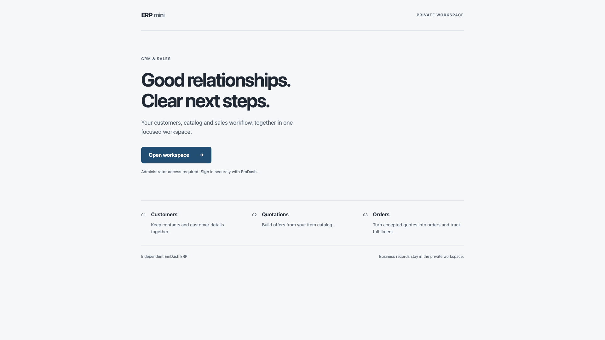

**Mục tiêu**

Đi từ trang công khai vào workspace riêng, không nhầm trang giới thiệu với nơi ghi sổ.

**Thao tác**

1. Mở địa chỉ được cấp. Với cài đặt dev sạch được bàn giao cùng bộ này: `http://localhost:4337` trên chính máy đang chạy dev. Giữ nguyên tên miền `localhost` khi đăng ký và dùng passkey.
2. Chọn **Open workspace**.
3. Nếu hệ thống đã có quản trị viên, đăng nhập; chỉ cài đặt mới chưa nhận chủ mới đưa bạn đến trình thiết lập.

**Kiểm tra trước khi tiếp tục**

Đúng tên miền/cổng của cơ sở bạn. `localhost` chỉ máy hiện tại, không phải địa chỉ cho nhân viên trên máy khác. Không dùng instance 4321 để thực hành theo bộ ảnh này.

**Lời đọc**

“Chúng ta bắt đầu ở trang mở đầu ERP mini. Trang này chỉ giúp đi vào không gian làm việc riêng; nó chưa phải màn hình nhập doanh thu hay sổ hộ kinh doanh. Bạn chọn Open workspace. Nếu cơ sở đã có người quản trị, hãy dùng tài khoản đã được cấp, không thiết lập lại hệ thống. Trong video, mọi thông tin đều là dữ liệu demo để học thao tác. Địa chỉ localhost chỉ dùng trên máy đang chạy ứng dụng; khi dùng hệ thống thật, bạn mở đúng địa chỉ do người vận hành cung cấp và không dùng dữ liệu thật để thử các tình huống lỗi.”

**Gợi ý dựng**

Phóng nút Open workspace, giữ chú thích “Dữ liệu DEMO — không phải hồ sơ thật”.

## 002 — Đặt tên site và chọn cách bắt đầu

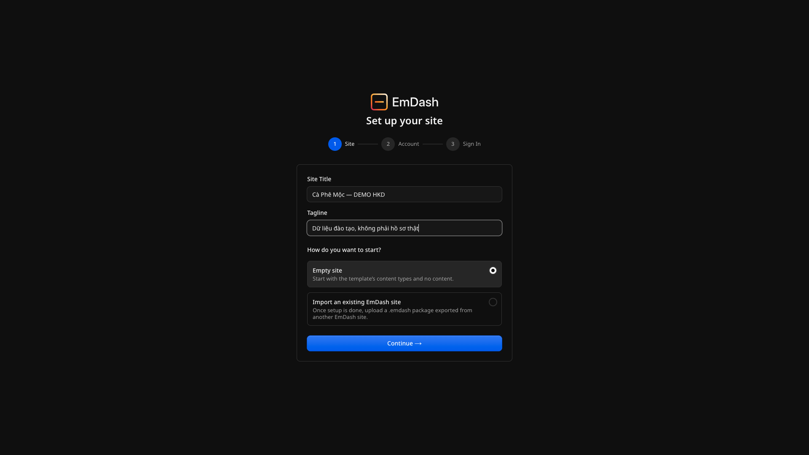

**Mục tiêu**

Nhận diện cài đặt trước khi tạo tài khoản đầu tiên.

**Thao tác**

1. Trên **Set up your site**, nhập **Site Title** và **Tagline**.
2. Ví dụ: `Cà Phê Mộc — DEMO HKD` và `Dữ liệu đào tạo, không phải hồ sơ thật`.
3. Chọn **Empty site**, rồi **Continue →**. Không chọn nhập một site cũ chỉ để lấy dữ liệu mẫu.

**Kiểm tra trước khi tiếp tục**

Đây là cài đặt mới bạn được phép nhận chủ. Tên site không thay danh tính pháp lý hộ trên hồ sơ HKD; danh tính đó sẽ được khai riêng.

**Lời đọc**

“Ở bước Site, mình đặt tên để nhận ra đúng cài đặt đang sử dụng. Tên trong ví dụ có chữ DEMO để không nhầm với cơ sở thật. Phần mô tả ngắn cũng nói rõ đây là dữ liệu đào tạo. Ta chọn Empty site, nghĩa là bắt đầu với các loại nội dung của mẫu nhưng không nhập một bộ dữ liệu kinh doanh có sẵn. Việc đặt tên site chưa thiết lập năm kế toán hoặc phương pháp thuế. Những thông tin quan trọng của hộ sẽ được kiểm tra ở phần Sổ HKD. Kiểm tra lại rồi bấm Continue để sang bước tạo tài khoản.”

## 003 — Tạo tài khoản quản trị đầu tiên

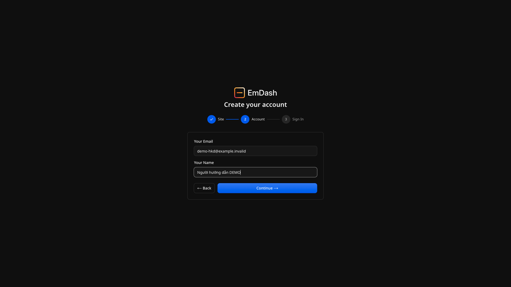

**Mục tiêu**

Tạo danh tính đăng nhập cho người được phép quản trị cài đặt mới.

**Thao tác**

1. Trên **Create your account**, nhập **Your Email** và **Your Name**.
2. Trong ảnh là `demo-hkd@example.invalid` và `Người hướng dẫn DEMO`; đó là thông tin giả, không dùng để nhận email.
3. Khi nhận chủ hệ thống thật, dùng email do bạn kiểm soát và tên phù hợp, rồi **Continue →**.

**Kiểm tra trước khi tiếp tục**

Tài khoản đầu tiên có quyền quản trị. Không chia sẻ tài khoản này cho cả nhóm; người vận hành cần cấp quyền phù hợp cho từng người sau đó.

**Lời đọc**

“Bước Account tạo người dùng đầu tiên của cài đặt. Đây là tài khoản quản trị, nên hãy nhập email bạn thực sự quản lý và một tên dễ nhận biết. Địa chỉ có đuôi example chấm invalid trong ảnh chỉ là ví dụ không nhận thư; bạn không sao chép nó khi dùng thật. Thông tin tài khoản dùng để biết ai đang thao tác, còn tên hộ và người đại diện trên sổ là thông tin khác, sẽ khai sau. Không nên để nhiều nhân viên dùng chung tài khoản quản trị vì sẽ khó đối chiếu người ghi chứng từ. Kiểm tra kỹ trước khi tiếp tục tạo phương thức đăng nhập.”

## 004 — Tạo passkey trên thiết bị của bạn

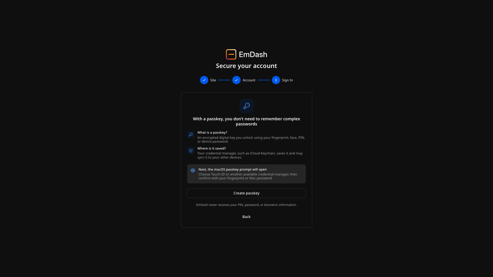

**Mục tiêu**

Đăng ký phương thức xác thực bảo mật thay vì tìm ô mật khẩu không có trong luồng này.

**Thao tác**

1. Đọc **Secure your account**, rồi chọn **Create passkey**.
2. Làm theo hộp thoại bảo mật của trình duyệt/hệ điều hành: chọn thiết bị hoặc trình quản lý thông tin xác thực và xác nhận bằng cách thiết bị hỗ trợ.
3. Không gửi PIN, mật khẩu thiết bị hoặc thông tin khôi phục cho người hỗ trợ.

**Kiểm tra trước khi tiếp tục**

Ảnh chỉ chụp nội dung trang; hộp thoại hệ điều hành không nằm trong ảnh. Ví dụ kiểm tra dùng thiết bị xác thực ảo riêng để không ghi dữ liệu sinh trắc học hay khóa của người thật.

**Lời đọc**

“Passkey là khóa đăng nhập được thiết bị hoặc trình quản lý thông tin xác thực của bạn giữ. Bạn không cần nghĩ ra mật khẩu cho màn hình này. Khi chọn Create passkey, hệ điều hành có thể yêu cầu vân tay, nhận diện khuôn mặt, PIN, mật khẩu thiết bị hoặc một phương thức khác tùy máy. Hộp thoại đó không xuất hiện trong ảnh chụp nội dung trang, nên giao diện trên máy bạn có thể khác. Chỉ xác nhận trên thiết bị mà bạn được phép dùng. Không đưa mã mở khóa hay thông tin khôi phục cho người khác; ứng dụng không cần bạn gửi những thông tin đó qua chat.”

## 005 — Kiểm tra passkey được tạo thành công

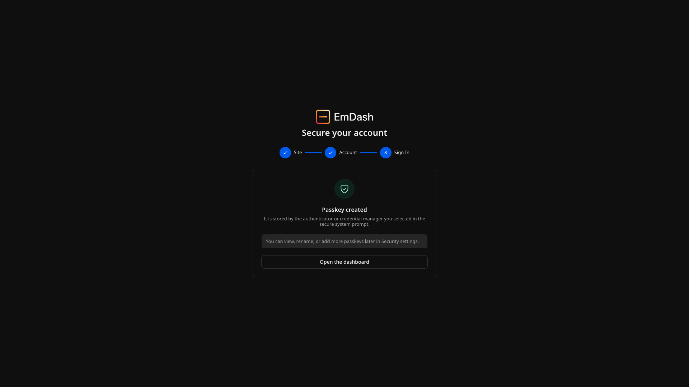

**Mục tiêu**

Xác nhận việc đăng ký đã hoàn tất trước khi vào dashboard.

**Thao tác**

1. Chờ thông báo **Passkey created**.
2. Ghi nhớ nơi bạn đã lưu passkey bằng cách quản lý an toàn của thiết bị; không chụp hoặc đưa khóa vào tài liệu hướng dẫn.
3. Chọn **Open the dashboard**.

**Kiểm tra trước khi tiếp tục**

Thông báo thành công không có nghĩa mọi trình duyệt hoặc thiết bị khác tự đăng nhập được. Khả năng đồng bộ phụ thuộc nơi bạn lưu passkey.

**Lời đọc**

“Khi trang báo Passkey created, việc tạo khóa đã thành công. Bạn nên biết mình đã lưu nó ở thiết bị hay trình quản lý nào để lần sau chọn đúng khi đăng nhập. Đừng hiểu rằng khóa vừa tạo chắc chắn đã có trên mọi máy; việc đồng bộ phụ thuộc dịch vụ bạn sử dụng. Không đưa khóa hoặc mã khôi phục vào video hướng dẫn. Bây giờ chọn Open the dashboard. Trong luồng được ghi ở đây, ứng dụng chuyển sang bước đăng nhập để xác nhận bạn thực sự sử dụng được passkey vừa đăng ký trước khi mở không gian quản trị.”

## 006 — Đăng nhập bằng passkey

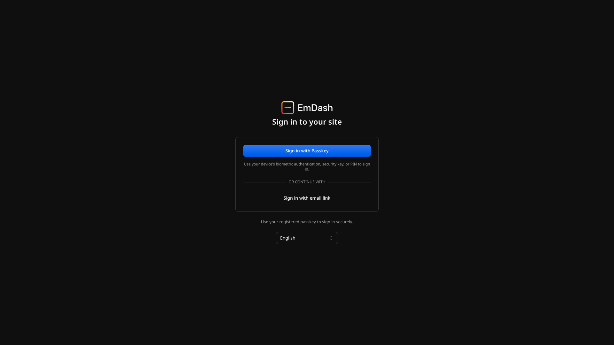

**Mục tiêu**

Đi vào phiên người dùng thật có quyền, không dùng đường bỏ qua đăng nhập để ghi sổ.

**Thao tác**

1. Chọn **Sign in with Passkey**.
2. Xác nhận theo thiết bị đã đăng ký và chờ dashboard tải xong.
3. Nếu muốn dùng **Sign in with email link**, trước hết phải có cấu hình/dịch vụ email phù hợp; video này không kiểm thử gửi email.

**Kiểm tra trước khi tiếp tục**

Giữ đúng địa chỉ cài đặt đã dùng khi đăng ký. Nếu mất passkey hoặc không có quyền, liên hệ người quản trị thay vì tạo lại hồ sơ hoặc dùng một tài khoản khác để đối soát lệnh cũ.

**Lời đọc**

“Ở màn hình đăng nhập, mình chọn Sign in with Passkey và xác nhận bằng thiết bị đã đăng ký. Hãy giữ đúng địa chỉ của cài đặt, vì xác thực bảo mật gắn với địa chỉ ứng dụng. Nút đăng nhập bằng email cũng có thể xuất hiện, nhưng video này không chứng minh dịch vụ gửi thư đã được cấu hình hay email chắc chắn sẽ tới. Ta dùng luồng passkey vừa hoàn tất. Nếu bạn không có quyền vào sổ hoặc không tìm thấy khóa, hãy nhờ người quản trị hỗ trợ. Đừng tạo một hồ sơ kinh doanh khác để thay cho việc xử lý quyền truy cập.”

## 007 — Nhận diện dashboard quản trị

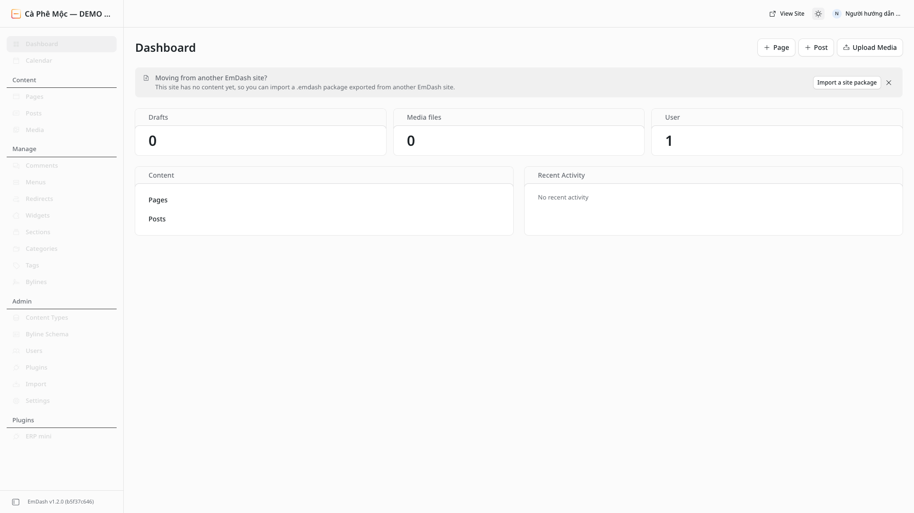

**Mục tiêu**

Phân biệt dashboard CMS với workspace ERP mini.

**Thao tác**

1. Chờ tên người dùng và menu quản trị tải đủ. Nếu hiện màn hình chào lần đầu, đọc và đóng bằng **Get Started**.
2. Bản quay dùng giao diện sáng; có thể đổi bằng nút chủ đề ở thanh trên. Đổi chủ đề không đổi dữ liệu hay quyền.
3. Trong nhóm **Plugins** ở thanh bên, chọn **ERP mini**.

**Kiểm tra trước khi tiếp tục**

Đúng người dùng và site. Các mục Pages/Posts/Media là nội dung CMS, không phải nơi ghi nghiệp vụ HKD.

**Lời đọc**

“Sau đăng nhập, ta thấy dashboard của EmDash. Các mục Pages, Posts và Media quản lý nội dung website, không phải chứng từ hộ kinh doanh. Nếu có màn hình chào đầu tiên, hãy đọc rồi đóng để nhìn rõ menu. Bản hướng dẫn chuyển sang giao diện sáng cho dễ xem; thao tác này chỉ thay cách hiển thị. Hãy kiểm tra tên site và tài khoản ở thanh trên. Để vào nghiệp vụ kinh doanh, tìm ERP mini trong nhóm Plugins ở bên trái. Không cần tạo bài viết hay trang nội dung trước khi sử dụng Sổ HKD.”

## 008 — Mở workspace VND và chọn Sổ HKD

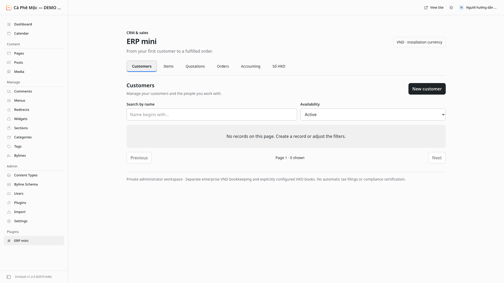

**Mục tiêu**

Tìm đúng luồng sổ hộ kinh doanh, tách khỏi CRM và sổ kép doanh nghiệp.

**Thao tác**

1. Chờ dòng **VND · installation currency** và các tab tải xong.
2. Chọn **Sổ HKD**, không chọn Accounting để import một bộ tài khoản.
3. Nếu không thấy tab hoặc bị từ chối, nhờ người vận hành kiểm tra cài đặt VND, plugin được bật và quyền tài khoản.

**Kiểm tra trước khi tiếp tục**

Customers/Items/Quotations/Orders không tự sinh doanh thu, tiền hay chi phí vào HKD. Không đổi tiền tệ của cài đặt đang có dữ liệu để thử mở chức năng.

**Lời đọc**

“Trong ERP mini, dòng VND cho biết tiền tệ của cài đặt. Ta chọn tab Sổ HKD. Tab Accounting bên cạnh là một luồng khác cho sổ kép doanh nghiệp; bạn không cần import bộ tài khoản để bắt đầu ví dụ hộ kinh doanh này. Các tab khách hàng, mặt hàng, báo giá và đơn hàng cũng độc lập: hoàn tất một đơn hàng không có nghĩa doanh thu hoặc tiền đã vào sổ HKD. Nếu tab không xuất hiện, đừng tự đổi tiền tệ của hệ thống đang có dữ liệu. Hãy nhờ người vận hành kiểm tra cài đặt và quyền trước khi tiếp tục.”

## 009 — Nhận biết cài đặt chưa có hồ sơ năm

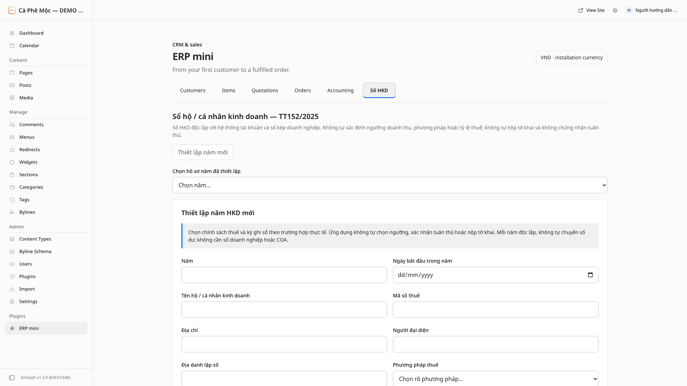

**Mục tiêu**

Bắt đầu ở khung thiết lập tự xuất hiện, không tìm một hồ sơ được tạo sẵn.

**Thao tác**

1. Đọc tiêu đề **Sổ hộ / cá nhân kinh doanh — TT152/2025** và phần giới hạn.
2. Khi chưa có hồ sơ nào, khung **Thiết lập năm HKD mới** xuất hiện sẵn. Nút **Thiết lập năm mới** chưa dùng được ở trạng thái này; không cần bấm thêm.
3. Nếu đã có hồ sơ, chọn đúng năm trong **Chọn hồ sơ năm đã thiết lập**. Không mở năm khác để sửa phương pháp của năm cũ.

**Kiểm tra trước khi tiếp tục**

Phần mềm chưa chọn hộ bạn phương pháp, kỳ hay tỷ lệ thuế. Hồ sơ năm là quyết định cần kiểm tra trước khi xác nhận.

**Lời đọc**

“Ở một cài đặt mới, chưa có năm HKD nào để chọn. Vì vậy khung thiết lập năm xuất hiện ngay bên dưới; bạn không phải bấm lại nút Thiết lập năm mới đang chưa dùng được. Trước khi nhập, hãy đọc dòng nhắc rằng ứng dụng không tự quyết định ngưỡng doanh thu, phương pháp thuế hoặc tỷ lệ. Khi hệ thống đã có dữ liệu, bạn sẽ chọn đúng hồ sơ năm thay vì tạo thêm cho tiện. Một năm mới không phải cách sửa chính sách đã chọn sai của năm cũ. Nếu chưa chắc phải chọn gì, dừng ở đây để đối chiếu với người phụ trách.”

## 010 — Kiểm tra toàn bộ chính sách trước xác nhận bất biến

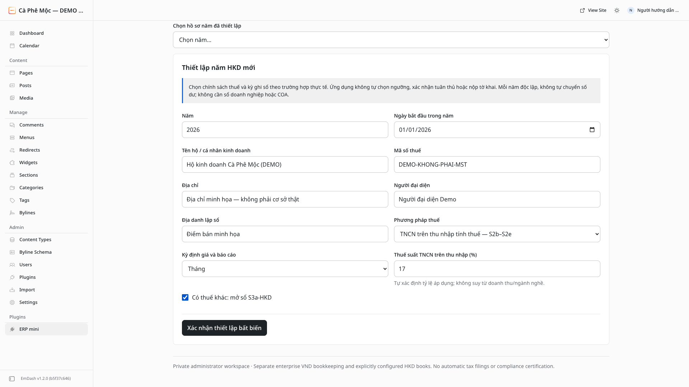

**Mục tiêu**

Chốt đúng danh tính và chính sách cho cả năm, không nhầm kỳ báo cáo với một bộ lọc có thể đổi tùy ý.

**Thao tác**

1. Ví dụ nhập **Năm 2026**, **Ngày bắt đầu trong năm 2026-01-01**.
2. Nhập danh tính giả đúng như ảnh: tên hộ `Hộ kinh doanh Cà Phê Mộc (DEMO)`, mã `DEMO-KHONG-PHAI-MST`, địa chỉ minh họa, người đại diện Demo và địa danh lập sổ. Mã trong ảnh cố ý không phải mã số thuế thật.
3. Chọn **TNCN trên thu nhập tính thuế — S2b–S2e**.
4. Chọn **Kỳ định giá và báo cáo: Tháng**. Kỳ này còn quyết định bình quân kho, không chỉ cách chia màn hình báo cáo.
5. Nhập **Thuế suất TNCN trên thu nhập: 17** và chọn **Có thuế khác: mở sổ S3a-HKD** để học các sổ trong bộ ví dụ. **17% chỉ là số minh họa, không phải mức mặc định hoặc khuyến nghị cho hộ của bạn.**
6. Đối chiếu lại toàn bộ thông tin, chọn **Xác nhận thiết lập bất biến**, đọc hộp xác nhận rồi chỉ đồng ý nếu chính sách đã đúng.

**Kiểm tra trước khi tiếp tục**

Danh tính, ngày bắt đầu, phương pháp, kỳ, thuế suất thu nhập và tùy chọn S3a đều không sửa/xóa sau xác nhận. Mỗi cài đặt demo phương pháp khác được ghi riêng; không thực hành đổi phương pháp bằng cách mở thêm năm.

**Lời đọc**

“Đây là bước phải kiểm tra kỹ nhất trước khi ghi nghiệp vụ. Năm và ngày bắt đầu xác định phạm vi sổ; tên hộ, mã số thuế, địa chỉ và người đại diện sẽ đi theo bản xuất. Ta chọn phương pháp thu nhập và kỳ tháng. Kỳ tháng không chỉ chia báo cáo: nó còn là kỳ tính bình quân giá xuất kho. Mười bảy phần trăm trong ảnh chỉ là con số đào tạo do người vận hành nhập, không phải phần mềm tự chọn hay mức áp dụng cho mọi hộ. Tùy chọn thuế khác mở thêm S3a trong ví dụ. Chỉ xác nhận khi tất cả đã đúng, vì hồ sơ này bất biến sau khi lưu.”

**Gợi ý dựng**

Dừng lần lượt ở phương pháp, kỳ, thuế suất và tùy chọn S3a; chèn lời nhắc biên tập “Không sao chép thuế suất demo vào hồ sơ thật”.

## 011 — Đối chiếu hồ sơ đã tạo và ba nhóm thao tác

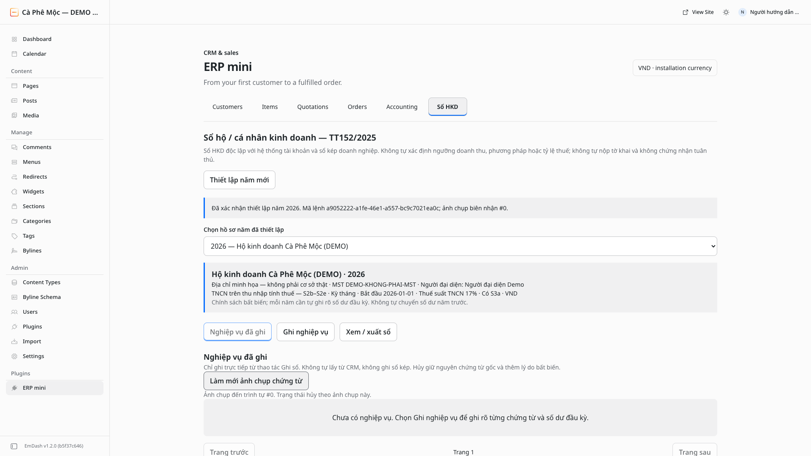

**Mục tiêu**

Xác nhận thiết lập thành công trước khi nhập số dư hoặc phát sinh.

**Thao tác**

1. Chờ thông báo xác nhận, kiểm tra hồ sơ **2026 — Hộ kinh doanh Cà Phê Mộc (DEMO)**.
2. Đọc lại phương pháp, **Kỳ tháng**, **Bắt đầu 2026-01-01**, **Thuế suất TNCN 17%**, **Có S3a**, **VND**.
3. Nhận diện ba nút: **Nghiệp vụ đã ghi**, **Ghi nghiệp vụ**, **Xem / xuất sổ**.
4. Sang chương tiếp để khai đầu kỳ kho và quỹ. Chưa có nghiệp vụ không đồng nghĩa ứng dụng sẽ tự tạo đầu kỳ bằng 0.

**Kiểm tra trước khi tiếp tục**

Thông báo xác nhận và hồ sơ đã chọn đều đúng. Khung hồ sơ không phải nút sửa chính sách; không có bản nháp trên máy chủ cho các nghiệp vụ sẽ ghi tiếp.

**Lời đọc**

“Sau khi xác nhận, kiểm tra lại khung hồ sơ năm ở ngay trên các nút nghiệp vụ. Nó cần thể hiện đúng hộ, năm, ngày bắt đầu, phương pháp và kỳ đã chọn. Chỉ một thông báo thành công chưa đủ nếu bạn đang nhìn nhầm hồ sơ. Ba nút bên dưới có ba việc khác nhau: xem lịch sử đã ghi, tạo nghiệp vụ mới và đọc hoặc xuất sổ. Bước tiếp theo là khai đầu kỳ cho từng mặt hàng và từng quỹ, kể cả số dư bằng không. Ứng dụng không tự chuyển số dư năm trước và không tự tạo đầu kỳ chỉ vì chưa thấy dữ liệu.”
