# 02 — Thu nhập, kho, tiền và sửa sai có lịch sử

Kịch bản đào tạo DEMO năm 2026, hồ sơ **Hộ kinh doanh Cà Phê Mộc (DEMO)**, phương pháp TNCN trên thu nhập, kỳ **tháng**, bắt đầu **01/01/2026**, có thuế khác. Các ảnh bên dưới thuộc lượt ghi hình giao diện dev; số liệu và tỷ lệ chỉ để học thao tác, không phải hướng dẫn xác định nghĩa vụ thuế thực tế. Đối chiếu phạm vi tại [contract Sổ HKD — bản nguồn cố định](https://github.com/ZeroHostCMS/zhst-community-plugins/blob/c99dc944188d3f0f608007b406bf11f9d1132208/plugins/erp-mini/docs/accounting.md#hkd-tt1522025).

## Quy ước thực hành

- Nhập tiền bằng đồng nguyên, ví dụ `1000000`; tài liệu viết **1.000.000 đồng** để dễ đọc. Số lượng dùng dấu chấm khi có phần lẻ, tối đa sáu chữ số thập phân.
- Mỗi lần ghi mới: chọn **Ghi nghiệp vụ**, nhập các trường trong khung hình, kiểm tra rồi bấm **Ghi sổ** và đọc hộp xác nhận trước khi đồng ý. Đây là ghi ngay, không phải lưu nháp. Chờ kết quả đã xác nhận trước khi ghi tiếp.
- **Ngày chứng từ** bằng ngày nghiệp vụ trong toàn bộ ví dụ này. Với mở đầu, ngày ghi số dư là **01/01/2026** theo hồ sơ; vẫn nhập Ngày chứng từ **01/01/2026**. Không suy rằng hai ngày luôn phải giống nhau trong dữ liệu thực.
- Sau mỗi lần ghi, giao diện trở về **Nghiệp vụ đã ghi**. Mở lại **Ghi nghiệp vụ** để tạo bản ghi tiếp theo. Kho, doanh thu, chi phí, thu/chi tiền và nghĩa vụ thuế là các bản ghi riêng; không có bước nào ở đây tự sinh toàn bộ các bước còn lại.
- Diễn giải là nội dung minh họa, có thể khác đôi chữ so với ảnh. Bạn viết rõ nghiệp vụ của mình; khi đối chiếu bộ demo, giữ đúng mã chứng từ, ngày, mặt hàng/quỹ và số tiền. Không coi việc gõ y hệt diễn giải là điều kiện ghi sổ.

## 012 — Khai số lượng và giá trị kho mở đầu

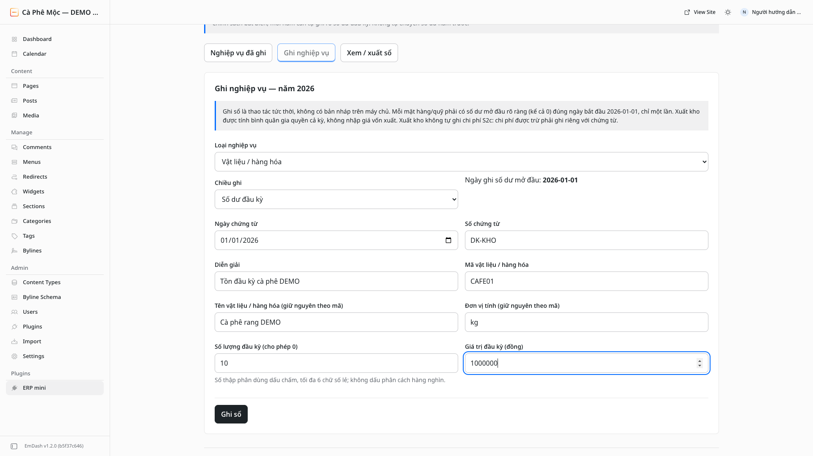

**Mục tiêu**

Đặt căn cứ tồn đầu cho mặt hàng trước khi ghi xuất hoặc nhập.

**Thao tác**

1. Chọn **Ghi nghiệp vụ** → **Loại nghiệp vụ: Vật liệu / hàng hóa** → **Chiều ghi: Số dư đầu kỳ**.
2. Kiểm tra ngày mở đầu **2026-01-01**; nhập **Ngày chứng từ: 2026-01-01**, **Số chứng từ: DK-KHO**, **Diễn giải: Tồn đầu kỳ cà phê DEMO**.
3. Nhập **Mã vật liệu / hàng hóa: CAFE01**, **Tên vật liệu / hàng hóa (giữ nguyên theo mã): Cà phê rang DEMO**, **Đơn vị tính (giữ nguyên theo mã): kg**.
4. Nhập **Số lượng đầu kỳ (cho phép 0): 10**, **Giá trị đầu kỳ (đồng): 1000000**; kiểm tra rồi **Ghi sổ**, xác nhận.

**Kiểm tra trước khi tiếp tục**

Chỉ một mở đầu cho CAFE01, đúng ngày 01/01; 10 kg có tổng giá trị 1.000.000 đồng, không phải đơn giá 1.000.000 đồng/kg.

**Lời đọc**

“Trước khi xuất cà phê, mình cần nói rõ kho bắt đầu có bao nhiêu. Ở đây có mười ki-lô-gam, tổng giá trị một triệu đồng. Vì vậy đơn giá bình quân ban đầu là một trăm nghìn đồng mỗi ki-lô-gam. Trường giá trị đầu kỳ nhận tổng tiền, không nhận đơn giá. Mã CAFE01 sẽ nhận diện mặt hàng trong những lần sau; tên và đơn vị cần giữ nguyên. Mỗi mặt hàng đều phải khai mở đầu, kể cả khi thực tế bắt đầu bằng không. Đây là dữ liệu minh họa, không phải số tồn được ứng dụng tự lấy từ năm trước.”

**Gợi ý dựng**

Dừng ở ba ô mã, lượng và tổng giá trị trước khi chuyển cảnh.

## 013 — Xuất 5 kg, không tự nhập giá vốn xuất

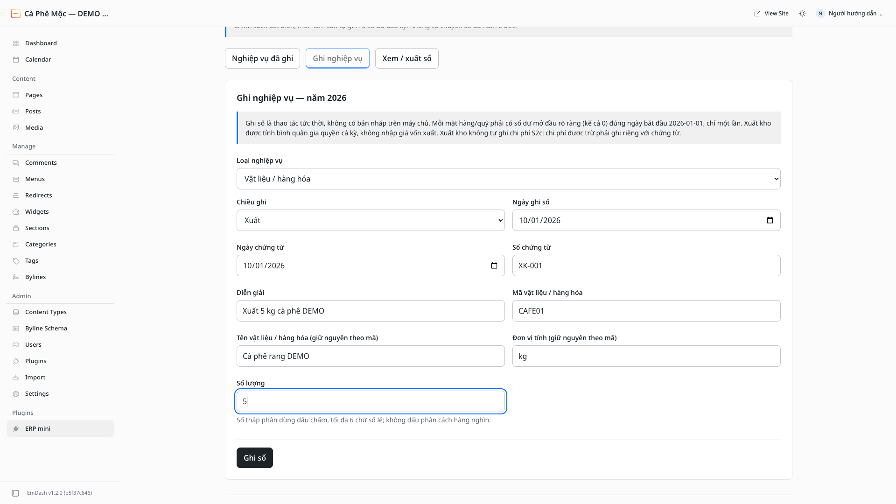

**Mục tiêu**

Ghi lượng xuất ngày 10/01 mà không nhầm với khoản chi tiền hoặc chi phí được trừ.

**Thao tác**

1. Tạo **Vật liệu / hàng hóa** mới, **Chiều ghi: Xuất**.
2. Nhập **Ngày ghi sổ** và **Ngày chứng từ: 2026-01-10**, **Số chứng từ: XK-001**, **Diễn giải: Xuất 5 kg cà phê DEMO**.
3. Nhập lại **CAFE01 / Cà phê rang DEMO / kg**, **Số lượng: 5**.
4. Kiểm tra rồi **Ghi sổ**, xác nhận. Không tìm ô nhập giá trị xuất: biểu mẫu xuất không có ô này.

**Kiểm tra trước khi tiếp tục**

Đúng chiều Xuất, lượng 5; không tạo thêm chứng từ chi tiền hoặc chi phí chỉ vì đã xuất kho.

**Lời đọc**

“Phiếu này chỉ nói rằng ngày mười tháng một, kho xuất năm ki-lô-gam cà phê. Khi chọn chiều xuất, biểu mẫu không yêu cầu giá trị xuất vì giá trị sẽ được tính theo bình quân gia quyền của cả kỳ. Đừng lấy tiền bán hàng hay số tiền trả nhà cung cấp để điền thay giá vốn. Cũng đừng hiểu rằng ghi xuất kho đã ghi xong chi phí tính thu nhập. Sổ kho theo dõi lượng và giá trị hàng; phần chi phí được trừ phải ghi riêng, có căn cứ chứng từ. Ta sẽ kiểm tra giá trị xuất sau khi bổ sung đủ các lần nhập của tháng.”

## 014 — Đọc kho trước khi có lần nhập trong tháng

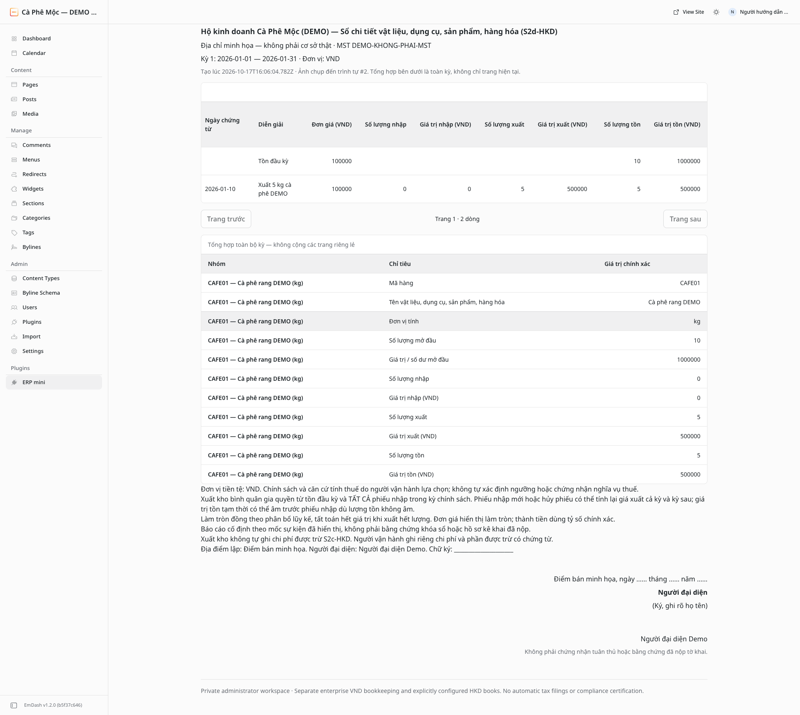

**Mục tiêu**

Nhận biết giá xuất hiện tại mới phản ánh các dữ liệu đã ghi.

**Thao tác**

1. Chọn **Xem / xuất sổ**, **Mẫu sổ: S2d-HKD — Sổ chi tiết vật liệu, dụng cụ, sản phẩm, hàng hóa**.
2. Chọn **Kỳ tháng: 1**, kiểm tra năm **2026**, khoảng **01/01–31/01**.
3. Đọc CAFE01 và tổng hợp toàn kỳ: mở đầu **10 kg / 1.000.000**, xuất **5 kg / 500.000**, cuối kỳ **5 kg / 500.000**.

**Kiểm tra trước khi tiếp tục**

Chưa có NK-001; phép kiểm là 1.000.000 ÷ 10 = **100.000 đồng/kg**. Đây không phải giá xuất cuối cùng sau khi ghi thêm nhập tháng một.

**Lời đọc**

“Ở thời điểm này, sổ mới biết tồn đầu mười ki-lô-gam trị giá một triệu và một lần xuất năm ki-lô-gam. Vì chưa có lần nhập trong tháng, giá bình quân đang là một trăm nghìn một ki-lô-gam. Giá trị xuất hiện là năm trăm nghìn, tồn còn năm ki-lô-gam cũng trị giá năm trăm nghìn. Hãy nhớ đây là kết quả theo dữ liệu hiện có, không phải lời hứa rằng giá xuất sẽ giữ nguyên. Với cách tính bình quân cả kỳ, một lần nhập được bổ sung sau đó trong cùng tháng có thể làm giá trị lần xuất trước thay đổi.”

## 015 — Nhập 10 kg ngày 20/01 với tổng giá trị 2.000.000

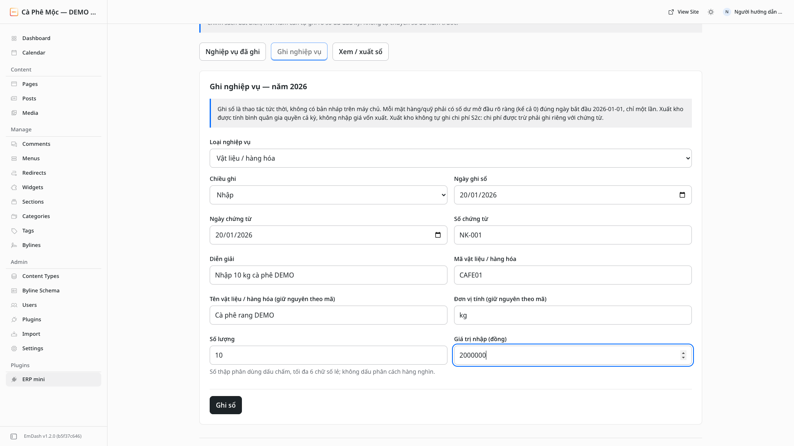

**Mục tiêu**

Bổ sung đủ căn cứ tính bình quân tháng trước khi chốt đối chiếu giá vốn.

**Thao tác**

1. Chọn **Ghi nghiệp vụ**, **Vật liệu / hàng hóa**, **Chiều ghi: Nhập**.
2. Nhập hai ngày **2026-01-20**, **Số chứng từ: NK-001**, **Diễn giải: Nhập 10 kg cà phê DEMO**.
3. Nhập **CAFE01 / Cà phê rang DEMO / kg**, **Số lượng: 10**, **Giá trị nhập (đồng): 2000000**.
4. Kiểm tra và **Ghi sổ**, xác nhận; chờ ghi thành công trước khi đối chiếu lại S2d và nhập GV-001.

**Kiểm tra trước khi tiếp tục**

2.000.000 là tổng giá trị của 10 kg, tương đương 200.000 đồng/kg riêng lô nhập. NK-001 không tự chi tiền, không tự sinh chi phí S2c.

**Lời đọc**

“Lần nhập ngày hai mươi có mười ki-lô-gam, tổng giá trị hai triệu đồng. Mặc dù ngày nhập nằm sau ngày xuất, nó vẫn thuộc cùng kỳ tháng một. Vì vậy toàn bộ lượng và giá trị nhập này được đưa vào bình quân của tháng. Mình cần hoàn tất NK-001 trước khi lấy giá trị xuất để đối chiếu giá vốn. Việc ghi phiếu nhập không có nghĩa nhà cung cấp đã được trả tiền, cũng không có nghĩa toàn bộ hàng mua đã thành chi phí được trừ. Kho nhận hàng, tiền thanh toán và chi phí tính thu nhập là ba việc phải kiểm tra riêng.”

## 016 — Kho định giá lại theo bình quân gia quyền cả tháng

**Mục tiêu**

Hiểu vì sao xuất ngày 10 được định giá lại dù nhập phát sinh ngày 20.

**Thao tác**

1. Trở lại **Xem / xuất sổ**, chọn **S2d-HKD**, **Kỳ tháng: 1**.
2. Đọc tổng mở đầu **10 kg / 1.000.000**, nhập **10 kg / 2.000.000**, xuất **5 kg / 750.000**, cuối kỳ **15 kg / 2.250.000**.
3. Đối chiếu thủ công: `(1000000 + 2000000) / (10 + 10) = 150000` đồng/kg; `5 × 150000 = 750000`.

**Kiểm tra trước khi tiếp tục**

Lượng xuất vẫn 5 kg. Chỉ giá trị xuất đổi từ **500.000 → 750.000** theo dữ liệu đủ hơn; chi phí S2c chưa tự được ghi hay tự điều chỉnh.

**Lời đọc**

“Bây giờ tổng nguồn hàng trong tháng là hai mươi ki-lô-gam, tổng giá trị ba triệu đồng. Chia ra, giá bình quân tháng là một trăm năm mươi nghìn đồng mỗi ki-lô-gam. Năm ki-lô-gam đã xuất được định giá bảy trăm năm mươi nghìn; mười lăm ki-lô-gam còn lại có giá trị hai triệu hai trăm năm mươi nghìn. Đây là bình quân gia quyền cả kỳ, không phải bình quân di động sau từng lần nhập. Nếu sau này bổ sung hoặc hủy phiếu nhập, cần đối chiếu lại giá vốn đã ghi riêng. Sổ kho thay đổi giá trị không tự sửa chứng từ chi phí S2c.”

**Gợi ý dựng**

Giữ hình ở tổng xuất và tồn; đọc phép tính chậm, không thêm dấu chú thích lên ảnh gốc.

## 017 — Mở đầu quỹ tiền mặt 2.000.000 đồng

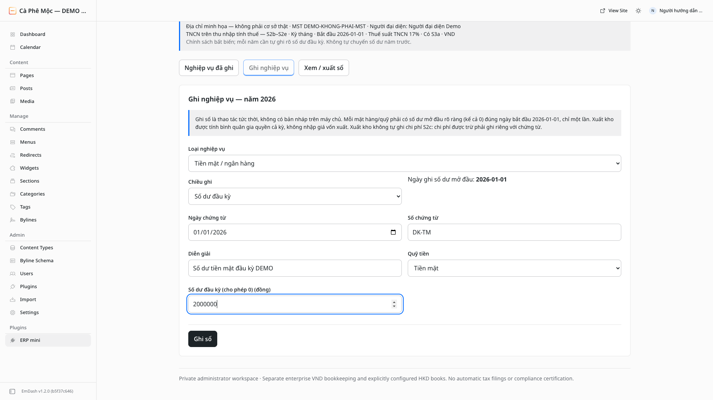

**Mục tiêu**

Khai căn cứ số dư quỹ trước khi thu, chi.

**Thao tác**

1. Tạo **Tiền mặt / ngân hàng**, **Chiều ghi: Số dư đầu kỳ**, **Quỹ tiền: Tiền mặt**.
2. Kiểm tra ngày mở đầu **2026-01-01**, nhập **Ngày chứng từ: 2026-01-01**, **Số chứng từ: DK-TM**, **Diễn giải: Số dư tiền mặt đầu kỳ DEMO**.
3. Nhập **Số dư đầu kỳ (cho phép 0) (đồng): 2000000**; kiểm tra rồi **Ghi sổ**, xác nhận.

**Kiểm tra trước khi tiếp tục**

Đây là số tiền thực có đầu kỳ, không phải doanh thu tháng một; không nhập thêm một khoản thu để tạo lại cùng số dư.

**Lời đọc**

“Kho có mở đầu riêng, quỹ tiền cũng vậy. Hai triệu đồng này là tiền mặt đã có khi bắt đầu sổ, không phải tiền bán hàng mới phát sinh. Chọn đúng chiều số dư đầu kỳ để ứng dụng biết căn cứ tính số dư về sau. Nếu ghi nó thành thu tiền bán hàng, câu chuyện kinh tế sẽ sai dù số tiền cuối cùng có thể trông giống nhau. Mỗi quỹ cần một mở đầu rõ ràng đúng ngày bắt đầu hồ sơ. Ta không dùng tồn kho để suy ra tiền mặt, vì hàng và tiền là hai loại tài sản khác nhau.”

## 018 — Mở đầu ngân hàng bằng 0 vẫn phải ghi

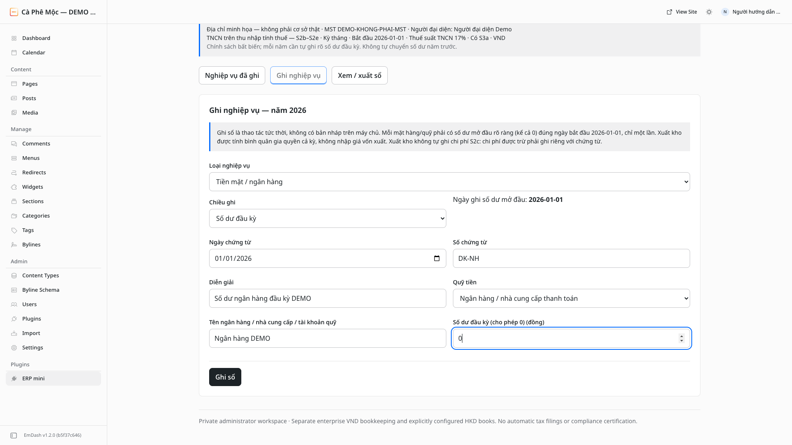

**Mục tiêu**

Khai rõ một quỹ ngân hàng bắt đầu không có tiền.

**Thao tác**

1. Tạo **Tiền mặt / ngân hàng**, **Số dư đầu kỳ**, **Quỹ tiền: Ngân hàng / nhà cung cấp thanh toán**.
2. Nhập **Tên ngân hàng / nhà cung cấp / tài khoản quỹ: Ngân hàng DEMO**.
3. Ngày mở đầu và **Ngày chứng từ: 2026-01-01**; **Số chứng từ: DK-NH**, **Diễn giải: Số dư Ngân hàng DEMO đầu kỳ bằng 0**.
4. Nhập rõ **Số dư đầu kỳ (cho phép 0) (đồng): 0**; **Ghi sổ**, xác nhận.

**Kiểm tra trước khi tiếp tục**

Ô số dư có số 0, không bỏ trống. Giữ nguyên tên Ngân hàng DEMO cho mọi phát sinh của quỹ này.

**Lời đọc**

“Không có tiền đầu kỳ không đồng nghĩa không cần mở quỹ. Mình vẫn khai Ngân hàng DEMO với số dư bằng không để ứng dụng có căn cứ tiếp nhận các khoản thu sau đó. Số không phải được nhập rõ; bỏ trống không phải là cách khai số không. Tên ngân hàng hoặc tài khoản quỹ cần dùng nhất quán để không vô tình theo dõi thành quỹ khác. Đầu kỳ này không làm tiền mặt tăng hay giảm, cũng không tạo doanh thu. Mỗi năm độc lập nên người vận hành phải đối chiếu và khai lại số dư, không chờ ứng dụng tự chuyển.”

## 019 — Chủ hộ bổ sung tiền ngân hàng, không phải doanh thu

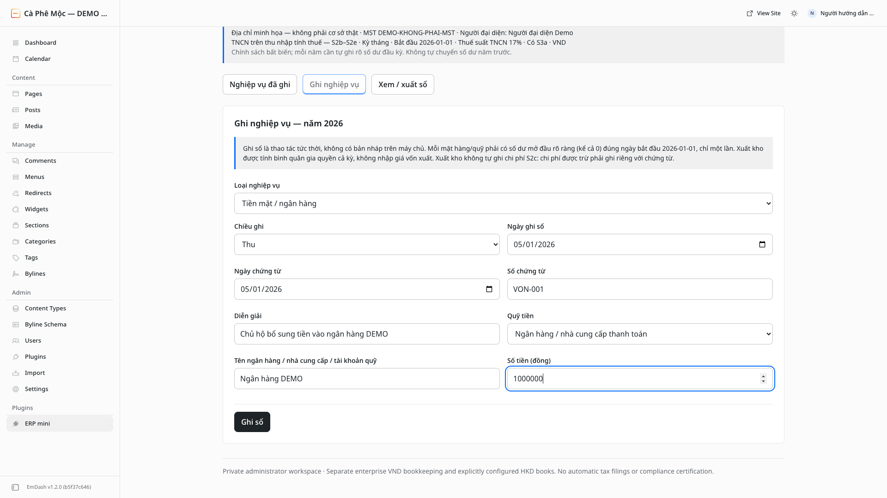

**Mục tiêu**

Phân biệt tiền vào quỹ với doanh thu bán hàng.

**Thao tác**

1. Tạo **Tiền mặt / ngân hàng**, **Chiều ghi: Thu**, chọn quỹ **Ngân hàng / nhà cung cấp thanh toán**, tên **Ngân hàng DEMO**.
2. Nhập hai ngày **2026-01-05**, **Số chứng từ: VON-001**, **Diễn giải: Chủ hộ bổ sung tiền vào Ngân hàng DEMO, không phải doanh thu**.
3. Nhập **Số tiền (đồng): 1000000**; kiểm tra rồi **Ghi sổ**, xác nhận.

**Kiểm tra trước khi tiếp tục**

Ngân hàng có 1.000.000 đồng sau khoản thu. Không ghi thêm Doanh thu cho VON-001; việc xác định đây là vốn bổ sung do người vận hành căn cứ thực tế, không có ô tự phân loại vốn.

**Lời đọc**

“Tiền vào ngân hàng chưa chắc là doanh thu. Ví dụ này là chủ hộ bổ sung một triệu đồng của mình vào quỹ, không phải khách trả tiền mua hàng. Vì vậy mình ghi khoản thu trong sổ tiền và diễn giải rõ nguồn tiền; không tạo một chứng từ doanh thu tương ứng. Giao diện không tự quyết định bản chất khoản tiền là vốn hay bán hàng thay cho người sử dụng. Sau bước này, ngân hàng có một triệu đồng, còn doanh thu kinh doanh vẫn chưa phát sinh từ khoản bổ sung ấy. Luôn đọc nguồn tiền và chứng từ trước khi quyết định ghi vào sổ nào.”

## 020 — Ghi doanh thu và hai căn cứ tính khác nhau

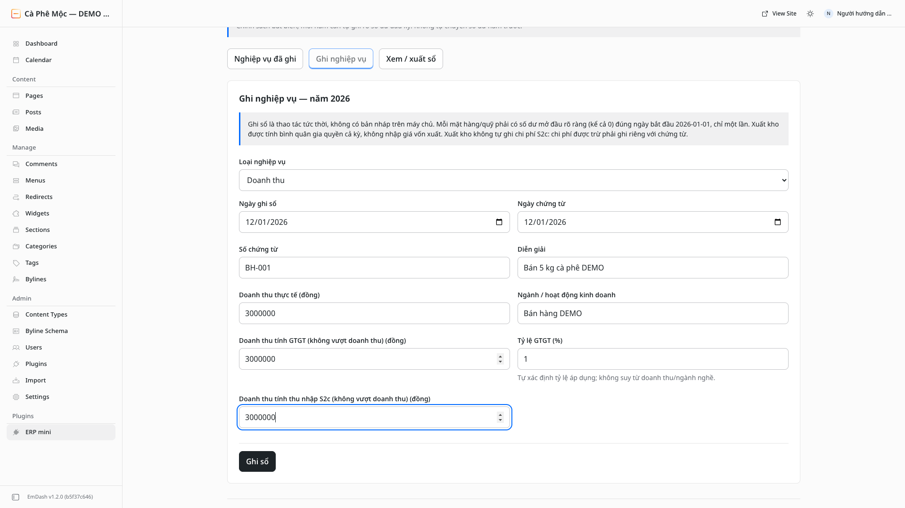

**Mục tiêu**

Ghi doanh thu bán hàng, căn cứ GTGT và doanh thu tính thu nhập, không nhầm với phiếu thu.

**Thao tác**

1. Tạo **Loại nghiệp vụ: Doanh thu**, hai ngày **2026-01-12**, **Số chứng từ: BH-001**, **Diễn giải: Bán hàng cà phê DEMO**.
2. Nhập **Doanh thu thực tế (đồng): 3000000**, **Ngành / hoạt động kinh doanh: Bán hàng DEMO**.
3. Nhập **Doanh thu tính GTGT (không vượt doanh thu) (đồng): 3000000**, **Tỷ lệ GTGT (%): 1**.
4. Nhập **Doanh thu tính thu nhập S2c (không vượt doanh thu) (đồng): 3000000**; kiểm tra rồi **Ghi sổ**, xác nhận.

**Kiểm tra trước khi tiếp tục**

Cả ba số tiền là 3.000.000 trong riêng ví dụ này, không phải luôn bằng nhau. GTGT 1% là giả định minh họa; TNCN 17% nằm ở hồ sơ thu nhập, không nhập thành tỷ lệ trên doanh thu ở phiếu này.

**Lời đọc**

“Ở phiếu bán hàng, mình khai ba ý khác nhau: doanh thu thực tế, doanh thu dùng tính GTGT và doanh thu đưa sang sổ tính thu nhập. Ví dụ cho cả ba cùng ba triệu đồng để dễ đối chiếu, nhưng không được mặc nhiên coi chúng luôn giống nhau. Tỷ lệ GTGT một phần trăm chỉ là con số đào tạo, người sử dụng phải xác định tỷ lệ thực tế từ căn cứ phù hợp. Thuế TNCN theo thu nhập sẽ xét doanh thu trừ chi phí được trừ ở S2c. Ghi BH-001 chưa làm tiền mặt tăng; khoản khách trả tiền cần một chứng từ thu riêng.”

## 021 — Thu tiền bán hàng vào tiền mặt

**Mục tiêu**

Ghi dòng tiền thực nhận, không nhân đôi doanh thu.

**Thao tác**

1. Tạo **Tiền mặt / ngân hàng**, **Chiều ghi: Thu**, **Quỹ tiền: Tiền mặt**.
2. Nhập hai ngày **2026-01-12**, **Số chứng từ: PT-001**, **Diễn giải: Thu tiền bán hàng BH-001**.
3. Nhập **Số tiền (đồng): 3000000**; kiểm tra rồi **Ghi sổ**, xác nhận.

**Kiểm tra trước khi tiếp tục**

Tiền mặt tăng từ 2.000.000 lên **5.000.000**. BH-001 vẫn chỉ ghi doanh thu một lần; PT-001 là bản ghi tiền riêng, không phải liên kết tự động.

**Lời đọc**

“Bây giờ mới đến tiền thực nhận từ khách. Mình ghi thu tiền mặt ba triệu đồng và nêu BH-001 trong diễn giải để dễ đối chiếu bằng mắt. Điều đó không tạo một liên kết thanh toán tự động giữa hai bản ghi. Doanh thu đã được ghi một lần ở bước trước, nên không tạo thêm doanh thu chỉ vì tiền vừa vào quỹ. Sau khoản thu, tiền mặt gồm hai triệu đầu kỳ cộng ba triệu nhận từ khách, thành năm triệu đồng. Nếu thực tế khách chưa trả, không được tự ghi phiếu thu chỉ để làm sổ tiền khớp với sổ doanh thu.”

## 022 — Ghi giá vốn riêng vào chi phí được trừ

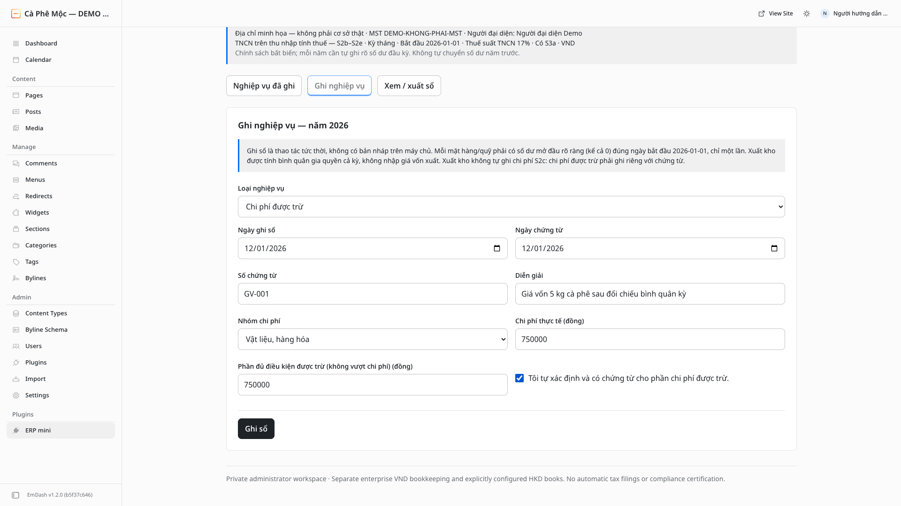

**Mục tiêu**

Đưa giá vốn đã đối chiếu vào S2c bằng chứng từ chi phí riêng.

**Thao tác**

1. Chỉ thực hiện sau khi NK-001 đã được ghi và S2d tháng một cho giá trị xuất **750.000**.
2. Tạo **Chi phí được trừ**, hai ngày **2026-01-12**, **Số chứng từ: GV-001**, **Diễn giải: Giá vốn cà phê xuất theo đối chiếu S2d tháng 1 DEMO**.
3. Chọn **Nhóm chi phí: Vật liệu, hàng hóa**; nhập **Chi phí thực tế (đồng): 750000**, **Phần đủ điều kiện được trừ (không vượt chi phí) (đồng): 750000**.
4. Đọc và đánh dấu **Tôi tự xác định và có chứng từ cho phần chi phí được trừ.**; **Ghi sổ**, xác nhận.

**Kiểm tra trước khi tiếp tục**

Không dùng giá xuất tạm 500.000 ở khung 014; không dùng toàn bộ giá trị mua 2.000.000. Việc ghi ngày 12 sau khi đã nhập phiếu ngày 20 là trình tự thao tác minh họa, không đổi ngày kinh tế của giá vốn.

**Lời đọc**

“Sau khi có đủ phiếu nhập tháng một, mình đối chiếu giá trị xuất là bảy trăm năm mươi nghìn đồng và ghi chi phí riêng. Sổ kho không tự tạo GV-001, cũng không tự sửa nó khi giá kho thay đổi. Ở ví dụ này, chi phí thực tế và phần được trừ cùng bằng bảy trăm năm mươi nghìn, dựa trên giả định đã có căn cứ chứng từ. Ô xác nhận nhắc rằng người ghi chịu trách nhiệm xác định phần được trừ; đánh dấu không biến một khoản chi thiếu điều kiện thành hợp lệ. Nếu bổ sung nhập sau này làm giá xuất đổi nữa, phải kiểm tra lại chứng từ chi phí.”

## 023 — Chi phí dịch vụ 500.000, ban đầu chỉ trừ 400.000

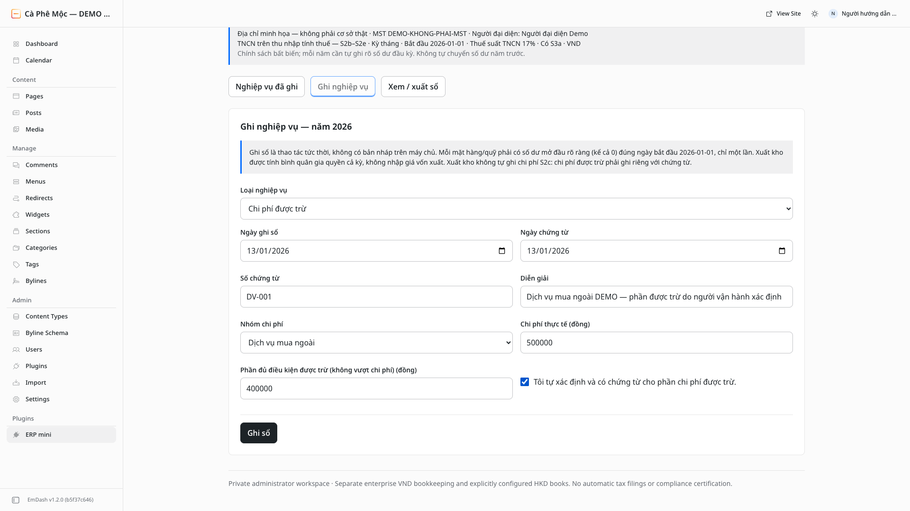

**Mục tiêu**

Tách số chi phí thực tế khỏi phần đủ điều kiện được trừ.

**Thao tác**

1. Tạo **Chi phí được trừ**, hai ngày **2026-01-13**, **Số chứng từ: DV-001**, **Diễn giải: Chi phí dịch vụ mua ngoài DEMO**.
2. Chọn **Nhóm chi phí: Dịch vụ mua ngoài**.
3. Nhập **Chi phí thực tế (đồng): 500000**, **Phần đủ điều kiện được trừ (không vượt chi phí) (đồng): 400000**.
4. Đọc và đánh dấu xác nhận có căn cứ chứng từ cho phần được trừ; **Ghi sổ**, xác nhận.

**Kiểm tra trước khi tiếp tục**

Chênh lệch **100.000** không được đưa vào phần trừ trong giai đoạn này. Chưa ghi trả tiền chỉ bằng việc ghi chi phí.

**Lời đọc**

“Dịch vụ thực tế tốn năm trăm nghìn đồng nhưng ở giai đoạn đầu, mình chỉ xác định bốn trăm nghìn đủ điều kiện được trừ. Đây là hai thông tin khác nhau, nên không giảm chi phí thực tế xuống bốn trăm nghìn để làm hai ô bằng nhau. Phần chênh một trăm nghìn vẫn thuộc khoản chi thực tế, chỉ không được dùng giảm thu nhập tính thuế theo căn cứ đang có. Ví dụ này phục vụ bài học sửa sai về sau, không đưa ra quy tắc pháp lý cho dịch vụ. Khoản chi tiền trả dịch vụ cũng cần ghi riêng đúng năm trăm nghìn, không theo số được trừ.”

## 024 — Chi tiền dịch vụ đúng 500.000 đồng

**Mục tiêu**

Ghi số tiền thực trả thay vì dùng số chi phí được trừ.

**Thao tác**

1. Tạo **Tiền mặt / ngân hàng**, **Chiều ghi: Chi**, **Quỹ tiền: Tiền mặt**.
2. Nhập hai ngày **2026-01-13**, **Số chứng từ: PC-DV-001**, **Diễn giải: Thanh toán dịch vụ DV-001 bằng tiền mặt**.
3. Nhập **Số tiền (đồng): 500000**; kiểm tra rồi **Ghi sổ**, xác nhận.

**Kiểm tra trước khi tiếp tục**

Tiền mặt còn **4.500.000**. Chi phí được trừ 400.000 không phải số tiền thanh toán; không ghi thêm một chi phí khác khi tạo phiếu chi.

**Lời đọc**

“Nhà cung cấp dịch vụ nhận năm trăm nghìn đồng, nên phiếu chi phải ghi năm trăm nghìn. Không lấy bốn trăm nghìn được trừ để thay số tiền thực trả. Sổ tiền trả lời quỹ giảm bao nhiêu; sổ chi phí trả lời chi phí nào và phần nào được trừ khi tính thu nhập. Hai câu trả lời có thể khác nhau mà vẫn đúng. Sau lần chi này, năm triệu đồng tiền mặt còn bốn triệu năm trăm nghìn. Mình đã có DV-001 cho chi phí, vì vậy phiếu chi chỉ ghi dòng tiền, không ghi thêm một khoản chi phí trùng lặp.”

## 025 — Thanh toán nhà cung cấp hàng 2.000.000 đồng

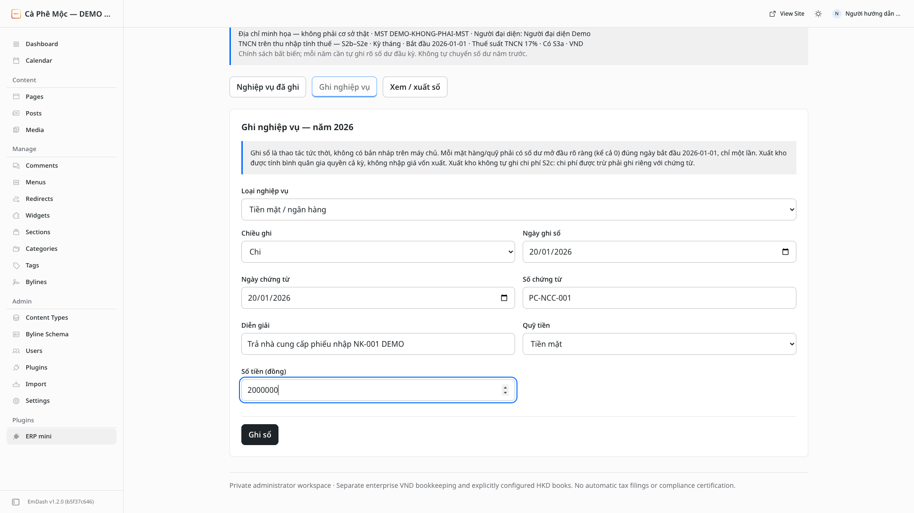

**Mục tiêu**

Ghi thanh toán hàng nhập mà không nhầm toàn bộ tiền mua thành giá vốn đã xuất.

**Thao tác**

1. Tạo **Tiền mặt / ngân hàng**, **Chiều ghi: Chi**, **Quỹ tiền: Tiền mặt**.
2. Nhập hai ngày **2026-01-20**, **Số chứng từ: PC-NCC-001**, **Diễn giải: Thanh toán nhà cung cấp cho hàng nhập NK-001**.
3. Nhập **Số tiền (đồng): 2000000**; kiểm tra rồi **Ghi sổ**, xác nhận.

**Kiểm tra trước khi tiếp tục**

Tiền mặt cuối các phát sinh này: `2000000 + 3000000 − 500000 − 2000000 = 2500000`. Không tạo chi phí được trừ 2.000.000 chỉ từ phiếu thanh toán này.

**Lời đọc**

“Kho đã nhận hàng ở NK-001, còn bước này ghi việc trả tiền cho nhà cung cấp. Hai triệu đồng ra khỏi quỹ tiền mặt, nên quỹ còn hai triệu năm trăm nghìn. Đừng coi toàn bộ tiền mua hàng là giá vốn đã xuất: trong kho vẫn còn hàng, và phần xuất của tháng đã được đối chiếu riêng là bảy trăm năm mươi nghìn. Phiếu nhập, phiếu trả tiền và chứng từ giá vốn có thể liên quan cùng một câu chuyện kinh doanh nhưng không thay thế nhau. Phần mềm không tự nối chúng thành một giao dịch đầy đủ; người ghi cần đối chiếu từng phần.”

## 026 — Ghi nghĩa vụ thuế khác, chưa phải nộp thuế

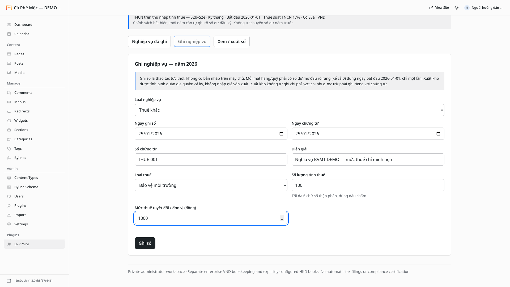

**Mục tiêu**

Minh họa tính thuế tuyệt đối và phân biệt nghĩa vụ với thanh toán.

**Thao tác**

1. Tạo **Loại nghiệp vụ: Thuế khác**, hai ngày **2026-01-25**, **Số chứng từ: THUE-001**.
2. Nhập **Diễn giải: Nghĩa vụ thuế bảo vệ môi trường minh họa, không gắn với mặt hàng CAFE01**.
3. Chọn **Loại thuế: Bảo vệ môi trường**, nhập **Số lượng tính thuế: 100**, **Mức thuế tuyệt đối / đơn vị (đồng): 1000**.
4. Kiểm tra rồi **Ghi sổ**, xác nhận.

**Kiểm tra trước khi tiếp tục**

Kết quả minh họa **100 × 1.000 = 100.000 đồng**. Không suy cà phê thuộc diện chịu thuế này; loại hàng và mức thuế trong bài chỉ là giả định đào tạo. Không tạo phiếu chi thuế trong kịch bản.

**Lời đọc**

“Khung hình này chỉ minh họa cách ghi một nghĩa vụ thuế khác theo mức tuyệt đối: một trăm đơn vị nhân một nghìn đồng, ra một trăm nghìn đồng. Không được suy từ ví dụ rằng cà phê của bài học chịu loại thuế này hoặc mức một nghìn là mức pháp luật áp dụng. Người sử dụng phải tự xác định đối tượng và căn cứ thực tế. Khi bấm ghi sổ, mình ghi nghĩa vụ để theo dõi ở S3a; ứng dụng không nộp tờ khai, không chuyển tiền cho cơ quan thuế và không tự giảm tiền mặt hay ngân hàng.”

## 027 — Đọc S2b: doanh thu 3.000.000 và GTGT 30.000

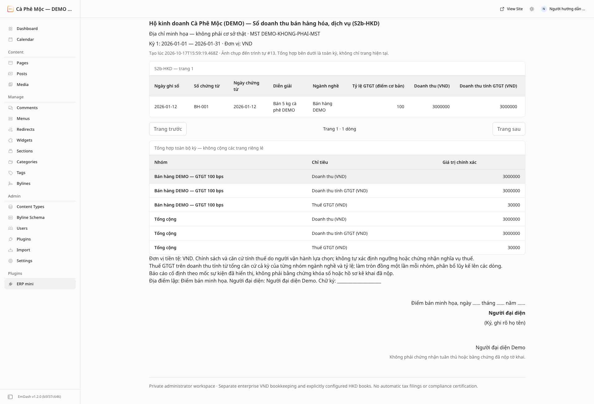

**Mục tiêu**

Đối chiếu doanh thu và GTGT, không tìm TNCN thu nhập trong sổ này.

**Thao tác**

1. Chọn **Xem / xuất sổ** → **Mẫu sổ: S2b-HKD — Sổ doanh thu bán hàng hóa, dịch vụ**, **Kỳ tháng: 1**.
2. Kiểm tra năm 2026, khoảng tháng một, dòng **BH-001**, ngành **Bán hàng DEMO**.
3. Đọc tổng doanh thu **3.000.000**, doanh thu tính GTGT **3.000.000**, thuế GTGT **30.000**.

**Kiểm tra trước khi tiếp tục**

`3000000 × 1% = 30000`. VON-001 không là doanh thu, PT-001 không tạo doanh thu lần hai. TNCN trên thu nhập xem ở S2c, không hiểu là bằng 0 vì không có tổng ấy ở S2b.

**Lời đọc**

“S2b cho mình kiểm tra phần bán hàng và GTGT. Tổng doanh thu là ba triệu đồng; với căn cứ ba triệu và tỷ lệ minh họa một phần trăm, GTGT là ba mươi nghìn đồng. Một triệu chủ hộ bổ sung vào ngân hàng không nằm trong doanh thu bán hàng. Phiếu thu ba triệu cũng không làm doanh thu thành sáu triệu, vì nó chỉ phản ánh tiền về quỹ. Hồ sơ này dùng phương pháp TNCN trên thu nhập, nên số TNCN cần xem ở S2c sau khi trừ chi phí được trừ. Không thấy TNCN trong S2b không có nghĩa nghĩa vụ ấy bằng không.”

## 028 — Đọc S2c trước điều chỉnh chứng từ dịch vụ

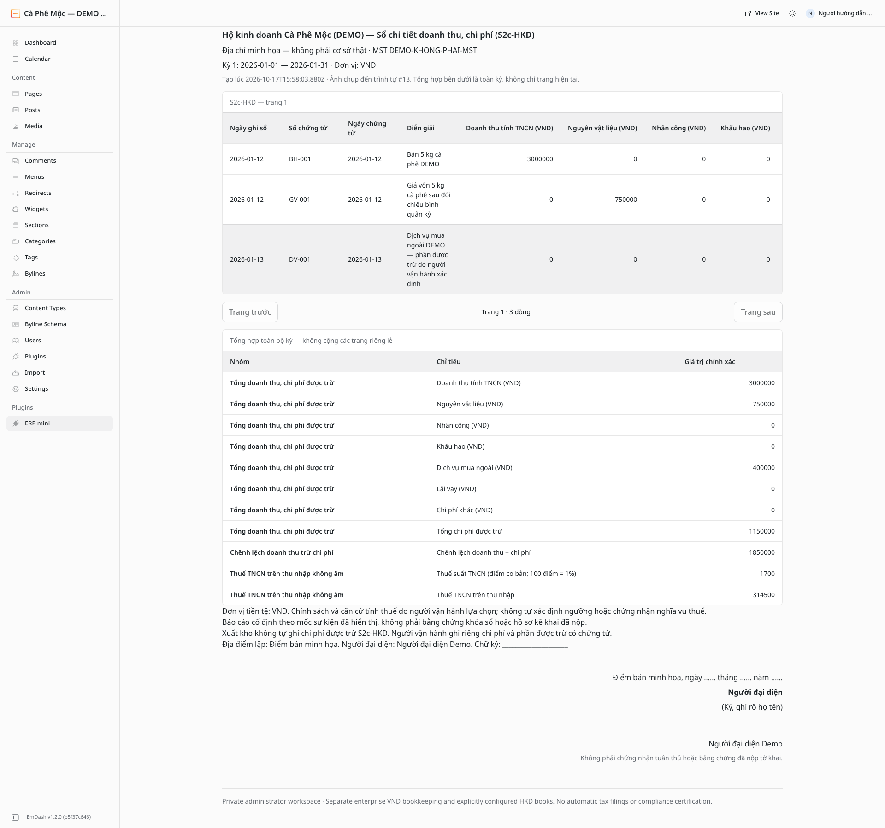

**Mục tiêu**

Chốt mốc đối chiếu ban đầu trước khi sửa DV-001.

**Thao tác**

1. Chọn **Mẫu sổ: S2c-HKD — Sổ chi tiết doanh thu, chi phí**, **Kỳ tháng: 1**.
2. Đối chiếu doanh thu tính thu nhập **3.000.000**, chi phí vật liệu được trừ **750.000**, dịch vụ được trừ **400.000**.
3. Đọc tổng được trừ **1.150.000**, chênh lệch doanh thu − chi phí **1.850.000**, thuế TNCN trên thu nhập **314.500**.

**Kiểm tra trước khi tiếp tục**

`750000 + 400000 = 1150000`; `3000000 − 1150000 = 1850000`; `1850000 × 17% = 314500`. Nếu ô thuế suất hiển thị **1700 điểm cơ bản**, đó là **17%**, không phải 1.700%.

**Lời đọc**

“Đây là mốc trước sửa sai. Doanh thu tính thu nhập ba triệu trừ giá vốn được trừ bảy trăm năm mươi nghìn và dịch vụ được trừ bốn trăm nghìn, còn một triệu tám trăm năm mươi nghìn. Áp dụng thuế suất hồ sơ mười bảy phần trăm của riêng bài minh họa, số TNCN là ba trăm mười bốn nghìn năm trăm đồng. Chi phí dịch vụ thực tế năm trăm nghìn không có nghĩa được trừ toàn bộ. Nếu bảng hiển thị thuế suất theo điểm cơ bản, một nghìn bảy trăm điểm tương ứng mười bảy phần trăm. Ta giữ mốc này để so sánh sau khi sửa chứng từ.”

## 029 — Đọc phần đầu S2d: đúng mặt hàng, đúng lượng

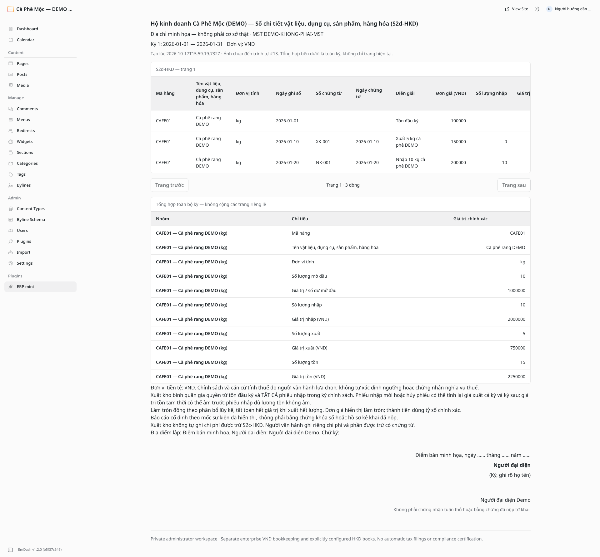

**Mục tiêu**

Kiểm tra danh tính hàng và diễn biến lượng trước khi nhìn tiền.

**Thao tác**

1. Chọn **S2d-HKD**, **Kỳ tháng: 1**; đưa vùng bảng ngang về phía trái.
2. Đọc mã **CAFE01**, tên **Cà phê rang DEMO**, đơn vị **kg**, các chứng từ **DK-KHO**, **XK-001**, **NK-001**.
3. Đối chiếu mở đầu **10**, nhập **10**, xuất **5**, cuối kỳ **15 kg**; đọc ngày ghi sổ để hiểu trình tự phát sinh.

**Kiểm tra trước khi tiếp tục**

`10 + 10 − 5 = 15`. Không nhầm thứ tự nhập liệu trong buổi học với ngày nghiệp vụ: XK-001 ngày 10, NK-001 ngày 20.

**Lời đọc**

“Bảng kho rộng nên mình đọc làm hai phần trên cùng một sổ. Trước hết nhìn phía trái để xác nhận đang theo dõi đúng mã CAFE01 và đúng đơn vị ki-lô-gam. Mở đầu mười, nhập thêm mười, xuất năm thì cuối kỳ còn mười lăm. Kiểm tra lượng trước giúp tránh trường hợp tiền có vẻ hợp lý nhưng sai mặt hàng hoặc sai đơn vị. Ngày xuất là mười tháng một và ngày nhập là hai mươi tháng một, dù mình đã hoàn thiện dữ liệu rồi mới ghi chứng từ giá vốn. Bình quân cả kỳ không làm thay đổi các ngày hoặc lượng đã ghi.”

## 030 — Đọc phần giá trị S2d và đối chiếu độc lập S2c

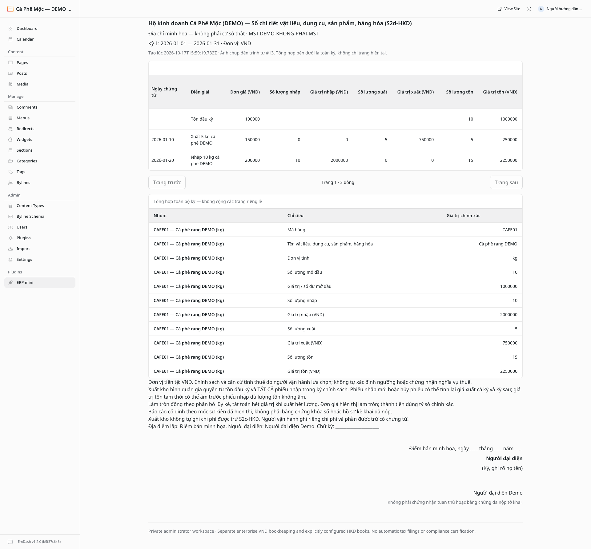

**Mục tiêu**

Kiểm tra tổng tiền kho và hiểu giới hạn tự động định giá lại.

**Thao tác**

1. Giữ **S2d-HKD**, tháng **1**; cuộn ngang trong vùng bảng sang phần cột giá trị, không đổi sang sổ khác.
2. Đọc các giá trị: mở đầu **1.000.000**, nhập **2.000.000**, xuất **750.000**, cuối kỳ **2.250.000**.
3. Đối chiếu với GV-001 đã ghi riêng: giá vốn **750.000**. Nếu có phát sinh nhập/hủy mới, đối chiếu lại trước khi sử dụng số chi phí.

**Kiểm tra trước khi tiếp tục**

`1000000 + 2000000 − 750000 = 2250000`. Khung 029 và 030 là hai vị trí ngang của cùng báo cáo; không cộng chúng như hai bộ số liệu.

**Lời đọc**

“Ở phần giá trị, một triệu đầu kỳ cộng hai triệu nhập trừ bảy trăm năm mươi nghìn xuất, còn hai triệu hai trăm năm mươi nghìn trong kho. Phần hàng còn lại không biến mất chỉ vì đã thanh toán nhà cung cấp. Mình cũng đối chiếu giá xuất với GV-001, vì chi phí S2c là bản ghi độc lập. Nếu sau này nhập thêm hoặc hủy nhập làm giá bình quân đổi, S2d có thể định giá lại xuất nhưng GV-001 không được tự sửa theo. Khi đó cần kiểm tra căn cứ và thực hiện quy trình sửa sai nếu cần, không coi hai sổ luôn tự đồng bộ.”

## 031 — Đọc S2e: tiền mặt và ngân hàng không gộp lẫn

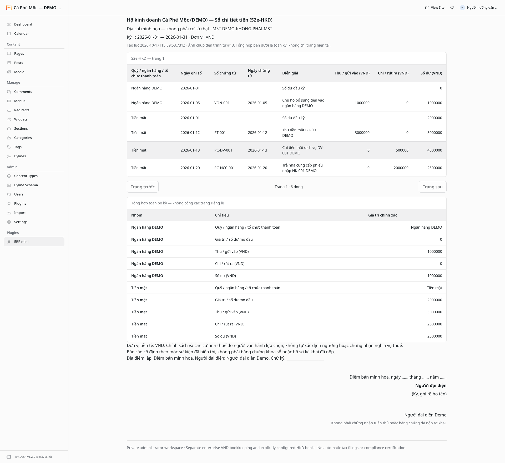

**Mục tiêu**

Đối chiếu từng quỹ bằng dòng tiền, không bằng lợi nhuận.

**Thao tác**

1. Chọn **S2e-HKD — Sổ chi tiết tiền**, **Kỳ tháng: 1**.
2. Đọc quỹ tiền mặt: mở đầu **2.000.000**, thu **3.000.000**, chi **2.500.000**, cuối kỳ **2.500.000**.
3. Đọc **Ngân hàng DEMO**: mở đầu **0**, thu **1.000.000**, chi **0**, cuối kỳ **1.000.000**.

**Kiểm tra trước khi tiếp tục**

Tiền mặt chi gồm dịch vụ **500.000** và nhà cung cấp **2.000.000**. Tổng hai quỹ cuối kỳ là **3.500.000**, nhưng không phải doanh thu hoặc thu nhập tính thuế.

**Lời đọc**

“Sổ tiền cần đối chiếu riêng từng quỹ. Tiền mặt bắt đầu hai triệu, thu ba triệu, chi năm trăm nghìn dịch vụ và hai triệu mua hàng, cuối kỳ còn hai triệu năm trăm nghìn. Ngân hàng bắt đầu bằng không, nhận một triệu chủ hộ bổ sung, nên còn một triệu. Cộng hai quỹ là ba triệu năm trăm nghìn nhưng không thể lấy số đó làm doanh thu hay lợi nhuận. Trong đó có tiền đầu kỳ và vốn bổ sung; ngược lại, tiền mua hàng còn liên quan hàng tồn kho. Cũng chưa có khoản chi nộp thuế nào trong kịch bản này.”

## 032 — Đọc S3a: nghĩa vụ 100.000 chưa phải đã thanh toán

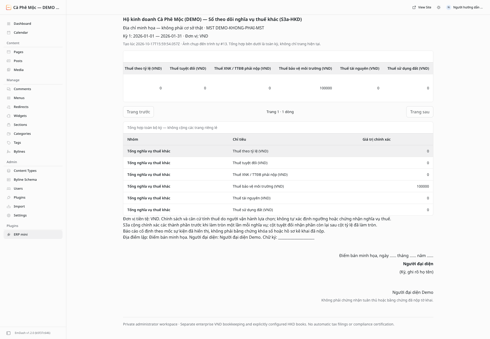

**Mục tiêu**

Xác nhận nghĩa vụ thuế khác được ghi đúng nơi và không tự giảm quỹ.

**Thao tác**

1. Chọn **S3a-HKD — Sổ theo dõi nghĩa vụ thuế khác**, **Kỳ tháng: 1**.
2. Đọc **THUE-001**, ngày **25/01/2026**, loại **Bảo vệ môi trường**, lượng **100**, mức tuyệt đối **1.000**, nghĩa vụ **100.000 đồng**.
3. Đối chiếu S2e vẫn là tiền mặt **2.500.000**, ngân hàng **1.000.000**; không thêm phiếu chi trong bài.

**Kiểm tra trước khi tiếp tục**

S3a có mặt vì hồ sơ đã bật thuế khác. Không coi báo cáo là bằng chứng đã nộp tờ khai, nộp thuế hay xác nhận đúng đối tượng chịu thuế.

**Lời đọc**

“S3a đang theo dõi một nghĩa vụ minh họa một trăm nghìn đồng. Hãy đọc đúng ý nghĩa: có bản ghi nghĩa vụ không đồng nghĩa tiền đã rời quỹ, cơ quan thuế đã nhận tờ khai hoặc hộ đã hoàn thành trách nhiệm. Sổ tiền vẫn giữ nguyên vì mình chưa ghi thanh toán thuế nào. Mức thuế và lượng ở đây chỉ phục vụ cách tính, không xác định hàng cà phê có chịu thuế bảo vệ môi trường hay không. Trước khi dùng số liệu thực, người vận hành cần kiểm tra đối tượng, hồ sơ và căn cứ pháp lý phù hợp thay vì dựa vào ví dụ đào tạo.”

## Bảng đối chiếu thủ công — trước và sau sửa DV-001

Hai cột dưới đây là **hai giai đoạn của cùng tháng 01/2026**, không phải hai kỳ để cộng lại. “Sau” là sau khi đã hủy DV-001 và ghi thành công DV-001-DC; không dùng số tạm giữa hai thao tác làm kết quả hoàn chỉnh.

| Chỉ tiêu / phép đối chiếu | Trước sửa | Sau thay thế đúng |
| --- | ---: | ---: |
| Doanh thu thực tế / doanh thu tính GTGT / doanh thu tính thu nhập | 3.000.000 / 3.000.000 / 3.000.000 | Không đổi |
| GTGT minh họa: 3.000.000 × 1% | 30.000 | 30.000 |
| Giá vốn thực tế và được trừ GV-001 | 750.000 / 750.000 | 750.000 / 750.000 |
| Dịch vụ thực tế / phần được trừ | 500.000 / 400.000 | 500.000 / 450.000 |
| Tổng chi phí thực tế: 750.000 + 500.000 | 1.250.000 | 1.250.000 |
| Tổng chi phí được trừ | 1.150.000 | 1.200.000 |
| Phần chi phí thực tế chưa được trừ | 100.000 | 50.000 |
| Thu nhập: 3.000.000 − tổng được trừ | 1.850.000 | 1.800.000 |
| TNCN minh họa: thu nhập × 17% | 314.500 | 306.000 |
| Kho: mở 10 kg / 1.000.000; nhập 10 kg / 2.000.000 | Bình quân 150.000/kg | Không đổi |
| Kho xuất / cuối kỳ | 5 kg / 750.000; 15 kg / 2.250.000 | Không đổi |
| Tiền mặt: 2.000.000 + 3.000.000 − 500.000 − 2.000.000 | 2.500.000 | 2.500.000 |
| Ngân hàng DEMO: 0 + 1.000.000 | 1.000.000 | 1.000.000 |
| Nghĩa vụ thuế khác minh họa: 100 × 1.000 | 100.000 | 100.000 |

Phần được trừ tăng **50.000**, thu nhập giảm **50.000**, TNCN giảm **8.500**. Không có dòng tiền mới. Các tỷ lệ **1%** và **17%** chỉ là giả định bài học, không phải kết luận áp dụng pháp luật.

## 033 — Hủy đúng DV-001 với lý do có thể đối chiếu

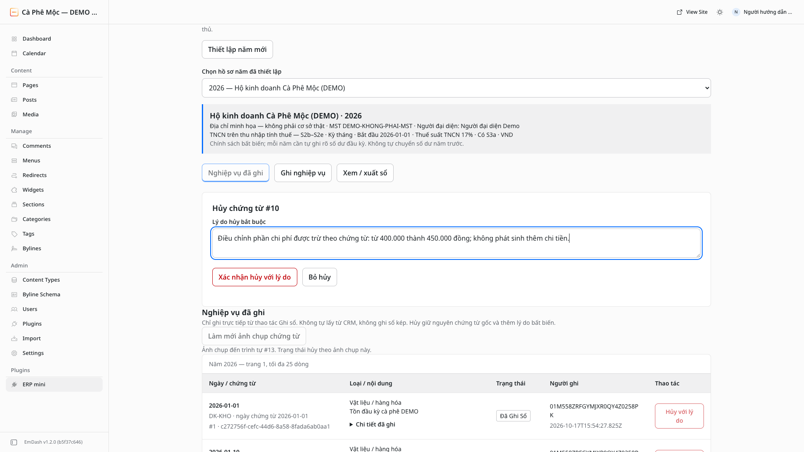

**Mục tiêu**

Sửa sai bằng lịch sử hủy và thay thế, không sửa đè hoặc hủy nhầm phiếu chi.

**Thao tác**

1. Chọn **Nghiệp vụ đã ghi**, tìm **DV-001** ngày **13/01/2026**, loại **Chi phí được trừ**; mở **Chi tiết đã ghi** để kiểm tra thực tế **500000**, được trừ **400000**.
2. Chọn **Hủy với lý do** trên chính dòng DV-001, không chọn PC-DV-001.
3. Nhập **Lý do hủy bắt buộc**: `Điều chỉnh căn cứ chứng từ dịch vụ: phần được trừ từ 400000 thành 450000 đồng; thay bằng DV-001-DC, chi phí thực tế vẫn 500000 đồng, không thanh toán lại.`
4. Kiểm tra lý do; bấm **Xác nhận hủy với lý do**, đọc hộp xác nhận rồi đồng ý.

**Kiểm tra trước khi tiếp tục**

Chỉ hủy bản ghi chi phí DV-001. Giữ PC-DV-001 vì tiền dịch vụ 500.000 đã trả đúng. Không hủy hồ sơ năm để sửa phần được trừ.

**Lời đọc**

“Sau khi đối chiếu chứng từ, mình xác định phần dịch vụ được trừ phải là bốn trăm năm mươi nghìn, không phải bốn trăm nghìn. Chứng từ đã ghi không được sửa đè, nên mình hủy đúng DV-001 với lý do rõ thay đổi gì và sẽ thay bằng chứng từ nào. Chú ý không hủy phiếu chi PC-DV-001: tiền đã trả năm trăm nghìn vẫn đúng, chỉ căn cứ tính phần được trừ thay đổi. Lý do giúp người kiểm tra sau này hiểu diễn biến, không phải một lời ghi chung chung. Thao tác hủy giữ lại chứng từ gốc và lịch sử thay vì xóa dấu vết.”

## 034 — Kiểm tra lịch sử đã hủy trước khi ghi thay thế

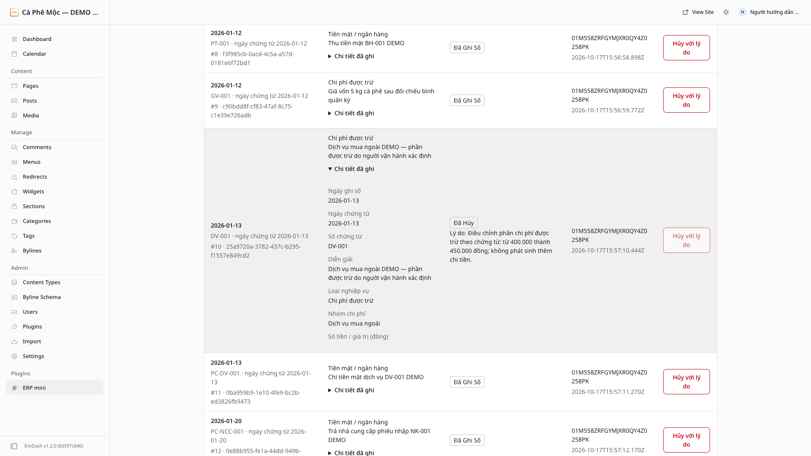

**Mục tiêu**

Xác nhận bước hủy thành công và giữ được dấu vết kiểm tra.

**Thao tác**

1. Trong **Nghiệp vụ đã ghi**, đọc lại dòng **DV-001**; nếu đang xem ảnh chụp cũ, chọn **Làm mới ảnh chụp chứng từ**.
2. Kiểm tra trạng thái **Đã hủy**, lý do đã nhập và **Chi tiết đã ghi** vẫn chứa giá trị gốc **500000 / 400000**.
3. Kiểm tra PC-DV-001 không bị hủy; chuẩn bị ghi bản thay thế, không tạo một phiếu chi mới.

**Kiểm tra trước khi tiếp tục**

Chưa có DV-001-DC thì quy trình sửa chưa hoàn tất. Nếu hủy bị từ chối, đọc lỗi và đối chiếu, không mặc nhiên coi đã hủy; thay đổi kho/tiền có thể bị chặn khi làm âm ở một thời điểm lịch sử.

**Lời đọc**

“Dòng DV-001 vẫn ở đây nhưng mang trạng thái đã hủy và có lý do. Đó là kết quả mong muốn: người xem vẫn biết trước đây đã ghi gì, ai ghi và vì sao cần thay. Các con số trong chi tiết gốc không đổi thành số mới; bản ghi thay thế sẽ thể hiện căn cứ đúng. Sau khi hủy mà chưa ghi thay thế, số chi phí đang thiếu khoản dịch vụ nên đây chỉ là trạng thái chuyển tiếp, chưa phải kết quả tháng hoàn chỉnh. Mình kiểm tra hủy thành công rồi mới tiếp tục, đồng thời giữ nguyên phiếu chi vì không có giao dịch trả tiền lần hai.”

## 035 — Ghi DV-001-DC với phần được trừ 450.000

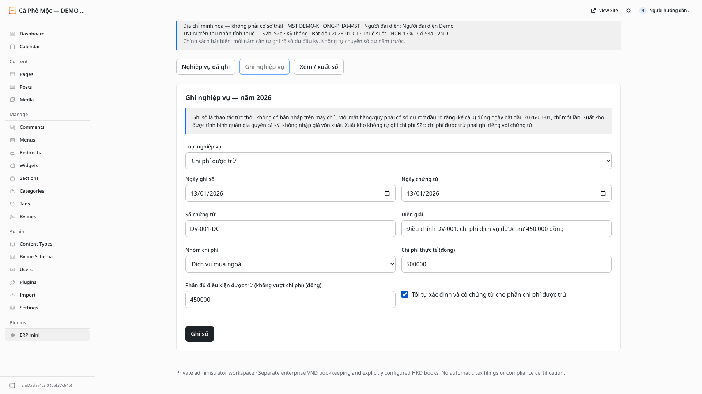

**Mục tiêu**

Khôi phục chi phí đúng bằng bản ghi mới, giữ nguyên số thực chi.

**Thao tác**

1. Chọn **Ghi nghiệp vụ** → **Chi phí được trừ**; nhập **Ngày ghi sổ** và **Ngày chứng từ: 2026-01-13**.
2. Nhập **Số chứng từ: DV-001-DC**, **Diễn giải: Thay DV-001 đã hủy, điều chỉnh phần được trừ dịch vụ từ 400000 thành 450000 đồng, không thanh toán lại**.
3. Chọn **Dịch vụ mua ngoài**, **Chi phí thực tế (đồng): 500000**, **Phần đủ điều kiện được trừ (không vượt chi phí) (đồng): 450000**.
4. Đọc và đánh dấu xác nhận căn cứ chứng từ, **Ghi sổ**, xác nhận. Không chuyển sang loại Tiền mặt / ngân hàng để chi lại.

**Kiểm tra trước khi tiếp tục**

DV-001 đã hủy, DV-001-DC đã ghi; dịch vụ chỉ đóng góp một phần chi phí được trừ đang hiệu lực **450.000**, không phải 400.000 + 450.000. PC-DV-001 vẫn là lần chi duy nhất **500.000**.

**Lời đọc**

“Bản mới có số DV-001-DC để nhận ra nó thay cho DV-001 đã hủy. Chi phí thực tế vẫn năm trăm nghìn, chỉ phần được trừ đổi thành bốn trăm năm mươi nghìn theo căn cứ đã đối chiếu. Mình dùng ngày nghiệp vụ mười ba tháng một của ví dụ, không tự chuyển chi phí sang tháng khác chỉ vì hôm nay mới sửa. Sau khi xác nhận, khoản dịch vụ có một bản đang hiệu lực và một bản lịch sử đã hủy. Tuyệt đối không chi thêm năm trăm nghìn: việc sửa số được trừ không có nghĩa nhà cung cấp nhận tiền lần nữa.”

## 036 — Đọc S2c sau sửa và kiểm tra các sổ không đổi

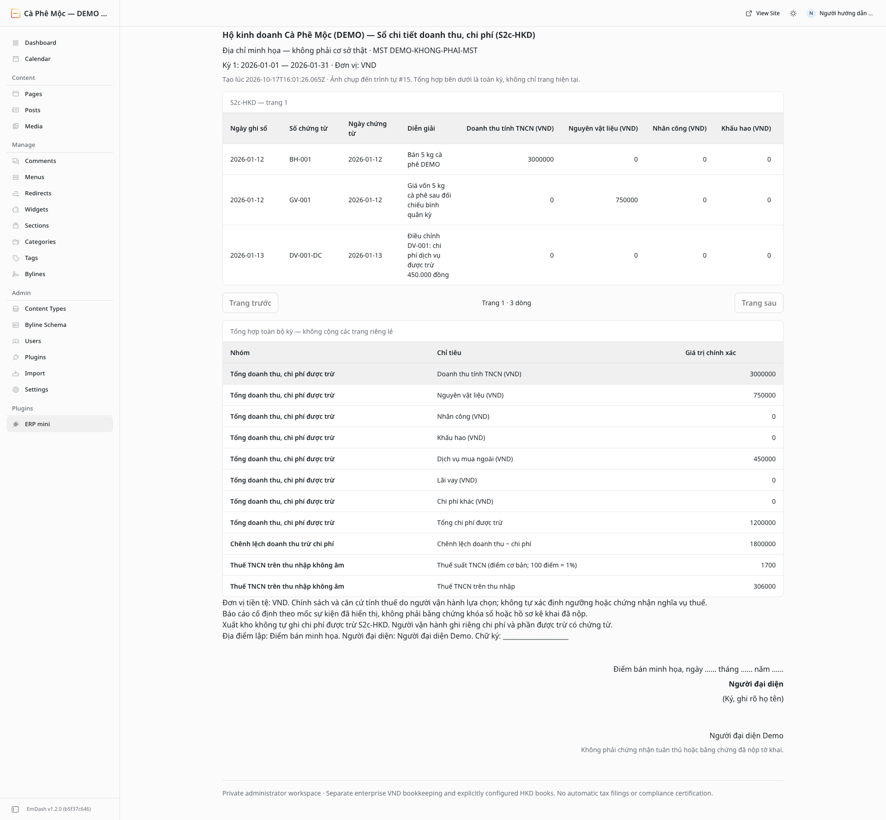

**Mục tiêu**

Khép kín sửa sai bằng số tổng đúng và đối chiếu không phát sinh thanh toán trùng.

**Thao tác**

1. Chọn **Xem / xuất sổ** → **S2c-HKD**, **Kỳ tháng: 1**, năm **2026**; lấy ảnh chụp mới sau thao tác thay thế.
2. Đối chiếu doanh thu tính thu nhập **3.000.000**, giá vốn được trừ **750.000**, dịch vụ được trừ **450.000**, tổng được trừ **1.200.000**.
3. Đọc chênh lệch **1.800.000**, TNCN minh họa **306.000** ở thuế suất **17%**; so với bảng đối chiếu hai giai đoạn.
4. Khi rà soát lại các sổ đã học, kiểm tra GTGT **30.000**, kho cuối **15 kg / 2.250.000**, tiền mặt **2.500.000**, ngân hàng **1.000.000**, nghĩa vụ thuế khác **100.000** vẫn không đổi.

**Kiểm tra trước khi tiếp tục**

`750000 + 450000 = 1200000`; `3000000 − 1200000 = 1800000`; `1800000 × 17% = 306000`. TNCN giảm **8.500** so với **314.500**, không phải khoản hoàn tiền tự động. Không cộng DV-001 đã hủy vào chi phí hiệu lực.

**Lời đọc**

“Sau khi thay chứng từ, tổng chi phí được trừ là một triệu hai trăm nghìn. Ba triệu doanh thu trừ khoản này còn một triệu tám trăm nghìn; nhân thuế suất minh họa mười bảy phần trăm được ba trăm linh sáu nghìn đồng. So với trước sửa, phần được trừ tăng năm mươi nghìn và số thuế tính ra giảm tám nghìn năm trăm. Đó là thay đổi kết quả tính, không phải ứng dụng tự hoàn tiền. Doanh thu, GTGT, lượng và giá trị kho, tiền mặt, ngân hàng đều giữ nguyên vì mình chỉ sửa căn cứ được trừ của dịch vụ, không bán thêm hàng, nhập thêm hàng hay trả thêm tiền.”

**Gợi ý dựng**

Dừng ở tổng chi phí được trừ và thuế TNCN; kết cảnh bằng lời nhắc “hủy đúng — ghi thay thế — không thanh toán trùng”.
