# Chương 3 — Xử lý lỗi, xuất sổ và nhận biết phương pháp khác

Tài liệu thao tác cho kịch bản ghi hình dev năm 2026, toàn bộ danh tính và số liệu đều minh họa. Các ảnh gốc được chụp từ giao diện thật ở các mốc thao tác của bộ hướng dẫn, không phải bằng chứng về dữ liệu của người đọc. Các tỷ lệ trong chương chỉ giúp kiểm tra phép tính, không phải khuyến nghị thuế. Phạm vi nghiệp vụ tham chiếu [Sổ HKD — TT152/2025, bản nguồn cố định](https://github.com/ZeroHostCMS/zhst-community-plugins/blob/c99dc944188d3f0f608007b406bf11f9d1132208/plugins/erp-mini/docs/accounting.md#hkd-tt1522025).

## 037 — Khoản chi bị từ chối vì làm âm tiền mặt

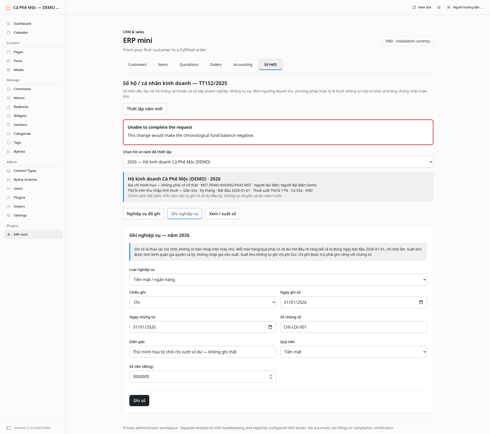

**Mục tiêu**

Phân biệt lỗi kiểm tra dữ liệu đã từ chối ghi với tình trạng chưa biết máy chủ đã ghi hay chưa.

**Thao tác**

1. Trong hồ sơ thu nhập 2026, mở **Ghi nghiệp vụ**, chọn **Tiền mặt / ngân hàng**, **Chiều ghi → Chi**, **Quỹ tiền → Tiền mặt**.
2. Nhập **Ngày ghi sổ** `2026-01-31`, **Ngày chứng từ** `2026-01-31`, **Số chứng từ** `CHI-LOI-001`, **Diễn giải** `DEMO kiểm tra chi vượt quỹ`, **Số tiền (đồng)** `3000000`.
3. Bấm **Ghi sổ**, đọc cảnh báo xác nhận và kết quả từ chối. Đây là lần thử minh họa; không điều chỉnh con số để cố ghi được.
4. Rời biểu mẫu bằng chức năng điều hướng trong workspace; nếu được hỏi bỏ nội dung chưa lưu, xác nhận bỏ lần nhập thử.

**Kiểm tra trước khi tiếp tục**

- Tiền mặt đúng trước thử là `2.500.000` đồng; chi `3.000.000` sẽ thiếu `500.000` đồng.
- Không có chứng từ `CHI-LOI-001` đã ghi; số dư vẫn `2.500.000` đồng.
- Đây phải là lỗi nghiệp vụ xác định không ghi, không phải thông báo **Chưa xác nhận kết quả lệnh HKD**.

**Lời đọc**

“Bây giờ chúng ta thử một khoản chi lớn hơn số tiền mặt hiện có. Quỹ đang có hai triệu năm trăm nghìn đồng, nhưng chứng từ đề nghị chi ba triệu. Ứng dụng từ chối vì khoản này làm âm quỹ. Đây là kiểm tra dữ liệu thật, không phải lời nhắc có thể bỏ qua. Bạn hãy kiểm tra quỹ đã chọn, ngày ghi, số dư đầu kỳ và chứng từ thu chi trước đó. Đừng giảm số tiền hoặc thêm một khoản thu không có căn cứ chỉ để vượt qua lỗi. Trong bài học, chúng ta bỏ lần nhập thử này; sổ tiền không thay đổi.”

**Gợi ý dựng**

Dừng ở lỗi và đối chiếu hai số `3.000.000` với `2.500.000`, không dựng cảnh ghi thành công.

## 038 — Quỹ mới cần đầu kỳ rõ ràng, kể cả bằng không

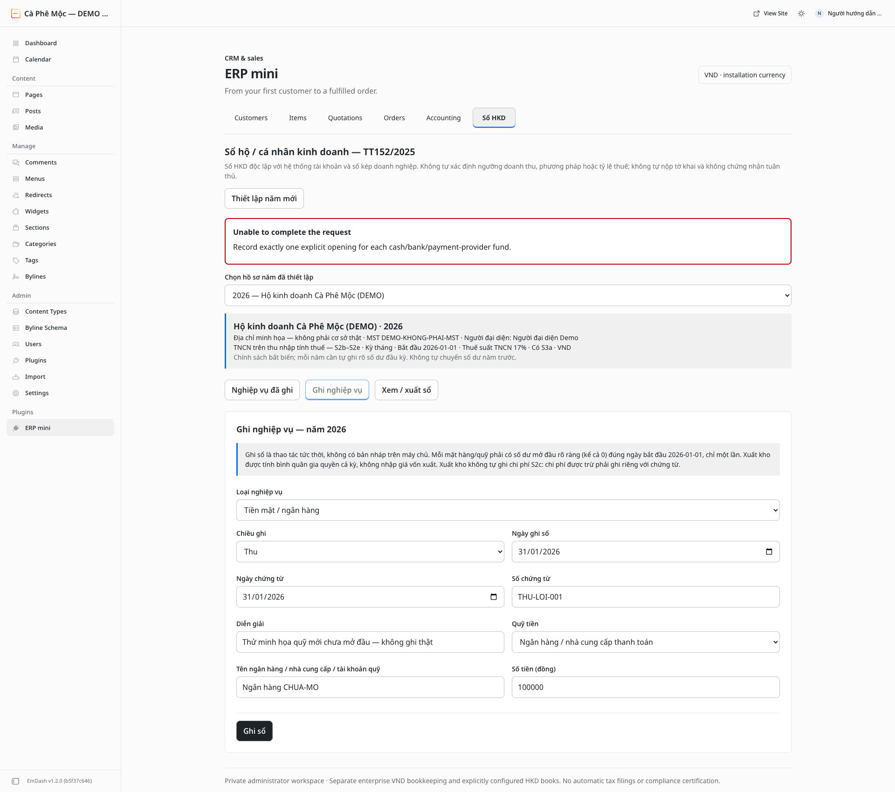

**Mục tiêu**

Hiểu rằng không có dòng đầu kỳ không đồng nghĩa với đầu kỳ bằng không.

**Thao tác**

1. Chọn **Ghi nghiệp vụ → Tiền mặt / ngân hàng**, **Chiều ghi → Thu**.
2. Chọn **Ngân hàng / nhà cung cấp thanh toán**; nhập **Tên ngân hàng / nhà cung cấp / tài khoản quỹ** `Ngân hàng CHUA-MO`.
3. Nhập ngày ghi và ngày chứng từ `2026-01-31`, số chứng từ `THU-LOI-001`, diễn giải `DEMO quỹ chưa mở đầu`, số tiền `100000`.
4. Bấm **Ghi sổ**, quan sát lỗi thiếu đầu kỳ; bỏ biểu mẫu thử, không ghi khoản thu này.

**Kiểm tra trước khi tiếp tục**

- `Ngân hàng CHUA-MO` khác `Ngân hàng DEMO`, không được mượn đầu kỳ của quỹ kia.
- Nếu thực sự cần dùng quỹ, phải có căn cứ và ghi đầu kỳ riêng đúng ngày bắt đầu `2026-01-01`; giá trị `0` vẫn phải khai rõ.
- Bài ghi hình không thêm đầu kỳ hoặc khoản thu thử này vào sổ đúng.

**Lời đọc**

“Quỹ ngân hàng mới chưa có dòng mở đầu nên một khoản thu một trăm nghìn đồng vẫn bị từ chối. Số không là một thông tin đã được xác nhận; thiếu thông tin lại là chuyện khác. Vì thế mỗi quỹ phải có đầu kỳ riêng, đúng ngày bắt đầu hồ sơ, kể cả khi số dư thực tế bằng không. Bạn cũng cần giữ tên quỹ nhất quán để không vô tình tạo một quỹ khác. Trong ví dụ này chúng ta chỉ quan sát lỗi rồi bỏ lần nhập. Với công việc thật, hãy đối chiếu sao kê và hồ sơ mở đầu trước khi ghi tiếp, không tự đặt số dư để làm hết cảnh báo.”

## 039 — Mất phản hồi không chứng minh rằng chưa ghi

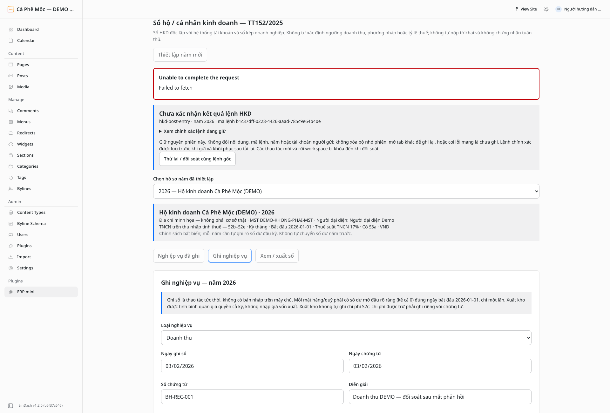

**Mục tiêu**

Nhận biết tình huống máy chủ có thể đã ghi nhưng trình duyệt chưa nhận được biên nhận.

**Thao tác**

1. Quan sát trường hợp doanh thu tháng 2 trị giá `10000` đồng vừa được gửi nhưng phản hồi không đến trình duyệt.
2. Đọc **Chưa xác nhận kết quả lệnh HKD** và mã lệnh đang giữ. Có thể mở **Xem chính xác lệnh đang giữ** để đối chiếu nội dung, không chỉnh sửa.
3. Giữ nguyên tab, tài khoản đăng nhập, hồ sơ và dữ liệu phiên. Không nhập lại doanh thu ở một biểu mẫu mới.

**Kiểm tra trước khi tiếp tục**

- Đây là tình huống trình diễn mất phản hồi sau khi máy chủ đã ghi; người dùng không cần và không nên chủ động gây lỗi mạng.
- Nội dung gốc gồm doanh thu thực tế `10000`, cơ sở GTGT `10000`, tỷ lệ GTGT `1%`, doanh thu tính thu nhập S2c `10000`; tỷ lệ chỉ minh họa.
- Không coi thông báo này như lỗi từ chối chắc chắn ở hai khung trước.

**Lời đọc**

“Thông báo này cần xử lý khác với lỗi thiếu tiền. Trình duyệt chưa xác nhận được kết quả, nhưng máy chủ có thể đã ghi xong. Trong lần trình diễn này, phản hồi bị mất sau khi doanh thu mười nghìn đồng đã được ghi thật. Nếu tạo chứng từ mới ngay, bạn có thể ghi trùng. Hãy giữ nguyên tab và lệnh đang được lưu, không đổi số tiền, năm hay người gửi. Phần xem lệnh giúp nhận diện chính xác yêu cầu cần đối soát. Bạn không phải làm gián đoạn mạng để thực hành; điều quan trọng là biết giữ nguyên lệnh khi sự cố xảy ra.”

**Gợi ý dựng**

Zoom thông báo và mã lệnh; không phóng lớn thông tin phiên hay thông tin đăng nhập.

## 040 — Tải lại vẫn phải đối soát lệnh gốc

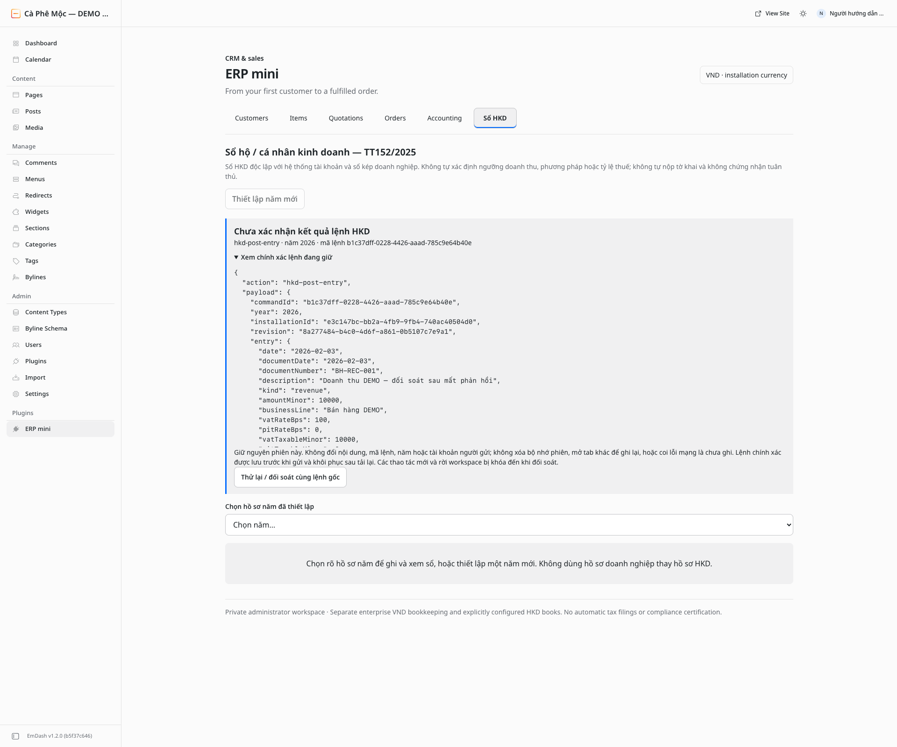

**Mục tiêu**

Khôi phục công việc sau tải lại mà không thay lệnh đang chờ bằng một lần ghi khác.

**Thao tác**

1. Trong chính tab đang giữ lệnh, tải lại trang và chờ hồ sơ năm được tải.
2. Đối chiếu mã lệnh và nội dung với khung trước; đọc lại **Chưa xác nhận kết quả lệnh HKD**.
3. Bấm **Thử lại / đối soát cùng lệnh gốc** khi nút cho phép; chờ kết quả, không bấm tạo nghiệp vụ mới.

**Kiểm tra trước khi tiếp tục**

- Không xóa bộ nhớ phiên, không mở tab khác để ghi lại, không đổi mã lệnh, năm, tài khoản người gửi hay tài nguyên cài đặt.
- Nếu hồ sơ gốc không tìm thấy hoặc thuộc cài đặt khác, dừng và nhờ người vận hành khôi phục đúng tài nguyên. Không gửi sang hồ sơ thay thế.
- Nếu không đọc được lệnh lưu, không tự đoán lại nội dung để gửi mới.

**Lời đọc**

“Tải lại trang không phải là hủy một giao dịch đã gửi. Khi vẫn ở đúng phiên trình duyệt, ứng dụng khôi phục lệnh đang cần đối soát và tiếp tục khóa các thao tác mới. Chúng ta kiểm tra cùng mã lệnh rồi dùng nút thử lại cùng lệnh gốc. Đây không phải tạo một khoản doanh thu thứ hai. Nếu hệ thống báo không tìm thấy hồ sơ gốc, đừng chọn một hồ sơ gần giống để tiếp tục. Hãy giữ thông tin lệnh và nhờ người vận hành kiểm tra đúng cài đặt. Xóa bộ nhớ phiên hoặc đổi tài khoản lúc này có thể làm mất đường đối chiếu an toàn.”

## 041 — Nhận biên nhận, kiểm tra chỉ một lần ghi

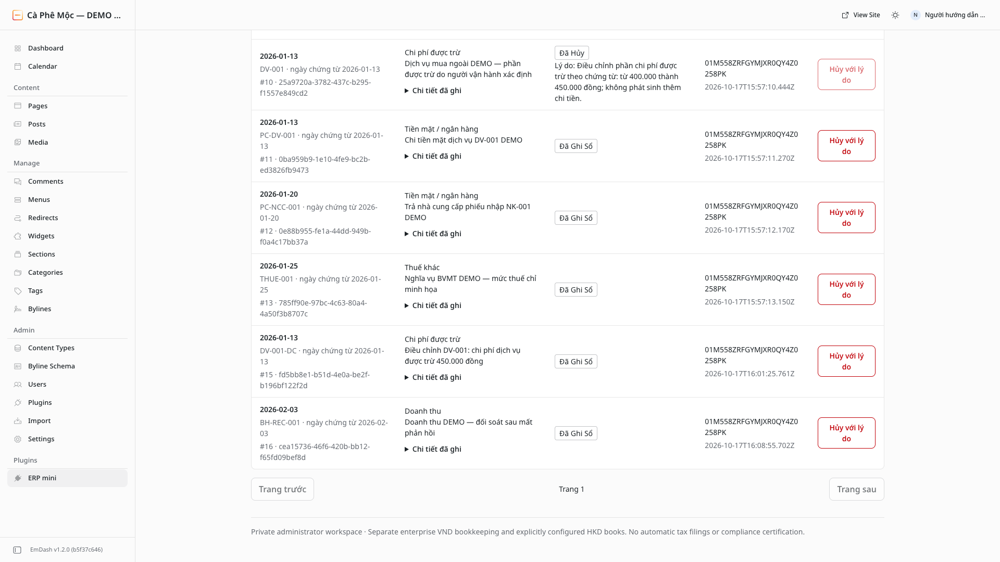

**Mục tiêu**

Kết thúc trạng thái chưa rõ kết quả bằng biên nhận và đối chiếu dữ liệu, không bằng suy đoán.

**Thao tác**

1. Chờ thao tác **Thử lại / đối soát cùng lệnh gốc** hoàn tất.
2. Khi khóa đối soát được gỡ, mở **Nghiệp vụ đã ghi**, dùng **Làm mới ảnh chụp chứng từ** nếu cần lấy dữ liệu mới.
3. Tìm chứng từ doanh thu `10000` đồng của lần gửi vừa rồi và kiểm tra chỉ có một dòng tương ứng.

**Kiểm tra trước khi tiếp tục**

- Thông báo chờ đối soát không còn; không có nghiệp vụ thay thế do người dùng tự nhập.
- Một lệnh gốc dẫn đến một lần ghi, dù đã tải lại và đối soát.
- Nếu vẫn chưa nhận kết quả chắc chắn, tiếp tục giữ nguyên lệnh; không làm theo bước ghi mới của bài tiếp theo.

**Lời đọc**

“Sau đối soát, ứng dụng nhận lại kết quả của đúng lệnh đã gửi trước đó. Chúng ta kiểm tra danh sách và thấy doanh thu mười nghìn đồng chỉ xuất hiện một lần. Điểm quan trọng không phải là bấm lại nhanh hay chậm, mà là dùng lại chính xác lệnh ban đầu. Khi chưa có kết quả chắc chắn, vẫn phải giữ lệnh và không tạo bản thay thế. Chỉ sau khi trạng thái đối soát kết thúc mới tiếp tục công việc bình thường. Cách này bảo vệ sổ khỏi ghi trùng khi đường truyền mất phản hồi, đồng thời giữ được căn cứ cho người vận hành nếu cần kiểm tra.”

## 042 — Trang đầu 25 dòng, tổng hợp là toàn tháng

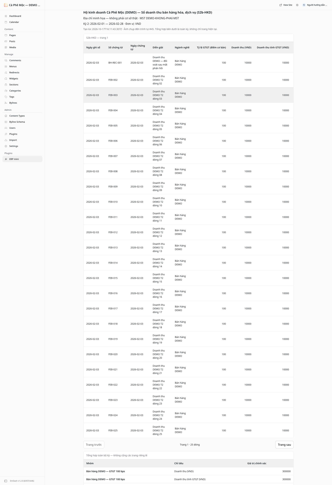

**Mục tiêu**

Đọc đúng sự khác nhau giữa số dòng hiện trên trang và tổng của cả kỳ.

**Thao tác**

1. Tại cài đặt thu nhập, chọn **Xem / xuất sổ → Mẫu sổ → S2b-HKD**, **Kỳ tháng → 2** của hồ sơ 2026.
2. Dùng **Làm mới ảnh chụp sổ** để bắt đầu lần đối chiếu mới khi dữ liệu tháng 2 đã đầy đủ.
3. Đọc **Trang 1 · 25 dòng**, mốc **Ảnh chụp đến trình tự** và bảng **Tổng hợp toàn bộ kỳ — không cộng các trang riêng lẻ**.

**Kiểm tra trước khi tiếp tục**

- Bộ dữ liệu minh họa tháng 2 có `30` dòng doanh thu, mỗi dòng `10.000` đồng; gồm một dòng đã đối soát và 29 dòng chuẩn bị cho bài phân trang.
- 29 dòng chuẩn bị không phải thao tác import hàng loạt trên giao diện người dùng.
- Tổng S2b cả tháng: doanh thu `300.000`, GTGT `3.000` đồng với cơ sở tổng `300.000` và tỷ lệ minh họa `1%`.

**Lời đọc**

“Tháng hai được chuẩn bị ba mươi dòng để chúng ta học cách đọc một sổ dài. Trang đầu chỉ hiển thị hai mươi lăm dòng, nhưng phần tổng hợp bên dưới đã là toàn tháng. Vì vậy đừng cộng tổng của trang một rồi cộng thêm cùng bảng tổng ở trang hai. Mốc trình tự cho biết ảnh chụp dữ liệu đang xem, giúp các trang nhất quán trong cùng lần đọc. Tổng doanh thu là ba trăm nghìn đồng và GTGT minh họa là ba nghìn đồng. Những dòng bổ sung phục vụ bài học đã được chuẩn bị trước; màn hình này không giới thiệu chức năng nhập hàng loạt.”

## 043 — Trang sau 5 dòng vẫn thuộc cùng ảnh chụp

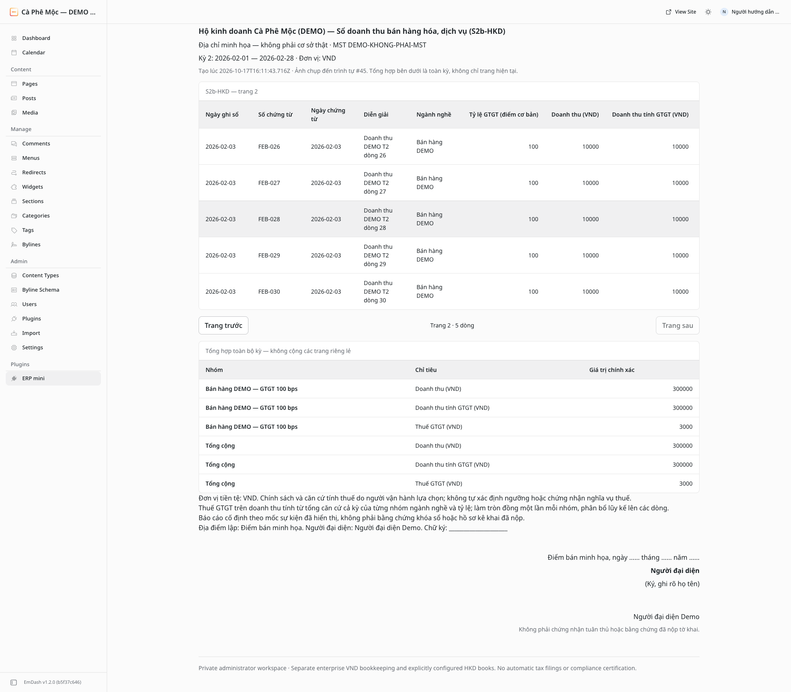

**Mục tiêu**

Đi qua các trang mà không nhầm trang cuối ít dòng là dữ liệu bị mất.

**Thao tác**

1. Từ trang 1, bấm **Trang sau** và đọc **Trang 2 · 5 dòng**.
2. Đối chiếu cùng mốc ảnh chụp, cùng tháng 2 và cùng mẫu S2b-HKD.
3. Có thể dùng **Trang trước** để quay lại 25 dòng đầu. Chỉ bấm **Làm mới ảnh chụp sổ** khi chủ động muốn lấy phát sinh mới.

**Kiểm tra trước khi tiếp tục**

- `25 + 5 = 30` dòng chi tiết; tổng hợp toàn kỳ vẫn doanh thu `300.000`, GTGT `3.000` đồng.
- **Trang trước** không tự cập nhật phát sinh mới; ảnh chụp được giữ xuyên các trang.
- Nếu xem thêm S2c cùng tháng: chi phí được trừ `0`, thu nhập `300.000`, TNCN minh họa `51.000` với mức hồ sơ `17%`.

**Lời đọc**

“Trang hai chỉ có năm dòng vì hai mươi lăm dòng đầu đã nằm ở trang trước. Đây là phân trang bình thường, không phải sổ thiếu hai mươi lăm chứng từ. Hãy kiểm tra tháng, mẫu sổ và mốc ảnh chụp trước khi đối chiếu con số. Nút trang trước đưa bạn về cùng ảnh chụp đang đọc, chứ không âm thầm lấy thêm nghiệp vụ vừa ghi. Nếu muốn xem dữ liệu mới nhất, hãy chủ động làm mới ảnh chụp rồi kiểm tra lại từ đầu. Khi xuất tệp hoặc in ở bước tiếp theo, chúng ta cần cả ba mươi dòng, không chỉ năm dòng đang nhìn thấy.”

## 044 — Xuất CSV đầy đủ khi đang ở trang cuối

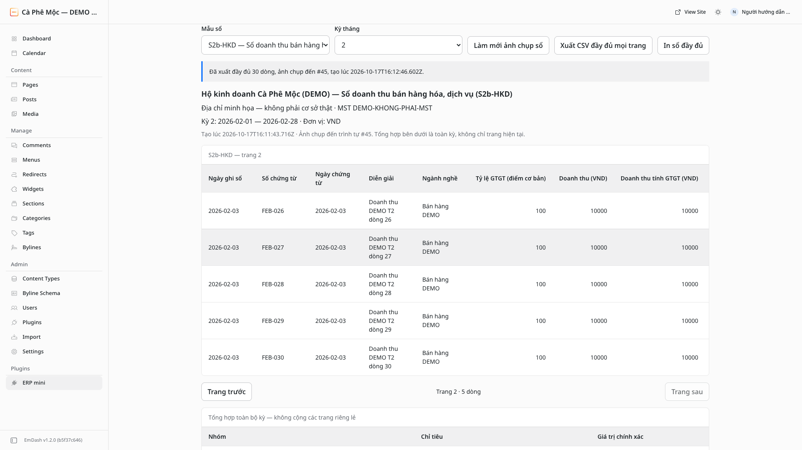

**Mục tiêu**

Xuất toàn bộ kỳ và kiểm tra tệp tải xuống, không nhầm ảnh ứng dụng với nội dung bảng tính.

**Thao tác**

1. Giữ S2b-HKD, tháng 2, trang 2 đang có 5 dòng; bấm **Xuất CSV đầy đủ mọi trang**.
2. Chờ thu thập xong và đọc thông báo **Đã xuất đầy đủ 30 dòng** cùng mốc ảnh chụp. Khung này chụp ứng dụng sau xuất, không phải ảnh một bảng tính dựng lại.
3. Trong danh sách tải xuống của trình duyệt, kiểm tra tệp `S2b-HKD-2026-2.csv` đã tải hoàn tất. Mở bản sao để đối chiếu bằng công cụ đọc CSV phù hợp, giữ nguyên tệp gốc.

**Kiểm tra trước khi tiếp tục**

- Đếm 30 dòng nghiệp vụ, không tính các dòng danh tính, tiêu đề, tổng hợp và chữ ký thành nghiệp vụ.
- Tệp có đúng hộ, năm, kỳ, đơn vị VND; tổng doanh thu `300.000`, GTGT `3.000` đồng.
- Ô văn bản bắt đầu bằng ký tự công thức có thể được thêm dấu bảo vệ. Không xóa dấu hàng loạt hoặc biến chúng thành công thức khi mở bảng tính.
- Thông báo xuất không thay việc kiểm tra tệp đã tải thành công.

**Lời đọc**

“Dù đang ở trang cuối chỉ có năm dòng, nút xuất đầy đủ sẽ thu thập mọi trang thuộc cùng ảnh chụp. Chúng ta chờ thông báo đủ ba mươi dòng, rồi kiểm tra riêng tệp trong danh sách tải xuống của trình duyệt. Hình đang thấy vẫn là ứng dụng, không phải một bảng tính giả lập. Khi mở CSV, hãy phân biệt dòng nghiệp vụ với các dòng thông tin và tổng hợp. Một số ô chữ có thể được bảo vệ để tránh bị phần mềm bảng tính hiểu thành công thức; hãy giữ bản gốc. Xuất sổ giúp đối chiếu và lưu bản đọc, nhưng chưa phải một bản sao lưu có thể phục hồi cả hệ thống.”

**Gợi ý dựng**

Giữ ảnh giao diện và thông báo đủ 30 dòng; việc kiểm tra tải xuống được giải thích bằng lời, không ghép bảng tính giả vào khung.

## 045 — Bản in đầy đủ tách khỏi khung quản trị

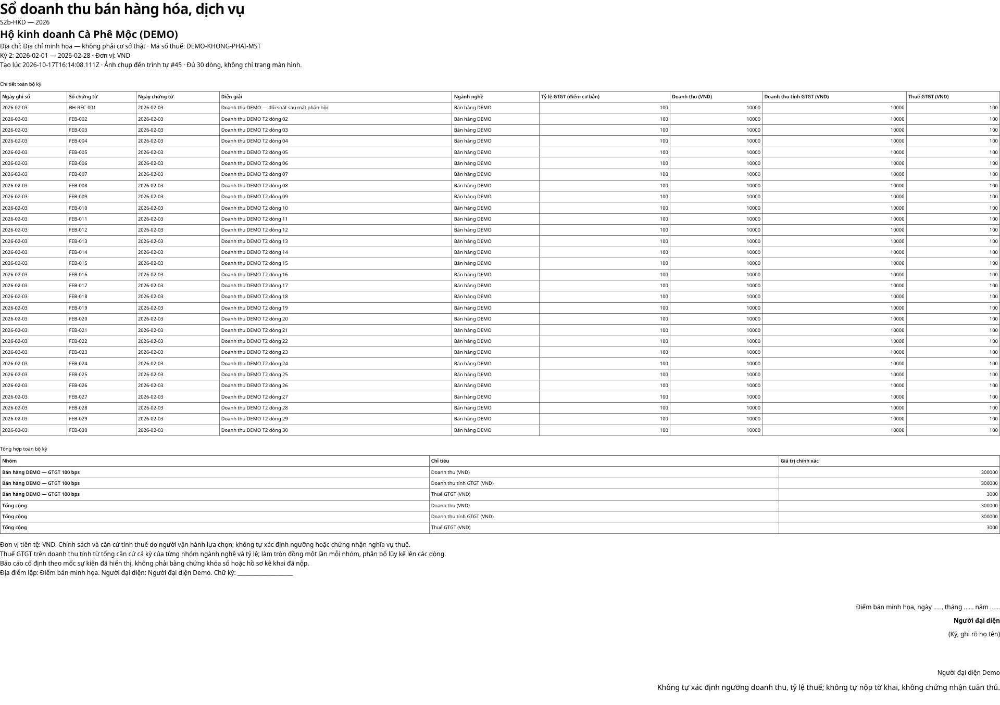

**Mục tiêu**

Kiểm tra bản in đủ nội dung trước khi lựa chọn in giấy hoặc lưu PDF bằng trình duyệt.

**Thao tác**

1. Từ sổ tháng 2, bấm **In sổ đầy đủ**, chờ thu thập xong 30 dòng.
2. Quan sát bản in của ứng dụng: danh tính, kỳ, mốc ảnh chụp, phần chi tiết toàn kỳ, tổng hợp và phần người đại diện. Bản in được tách khỏi khung quản trị.
3. Nếu hộp thoại in của trình duyệt/hệ điều hành mở, kiểm tra khổ giấy và phân trang tại đó; không xem hộp thoại này là một màn hình nghiệp vụ trong ảnh hướng dẫn. Khi cần trở lại ứng dụng, đóng hoặc hủy hộp thoại in rồi dùng **Đóng bản in / trở lại sổ**.

**Kiểm tra trước khi tiếp tục**

- Bản xem trước thực có nội dung đủ `30` dòng, không chỉ 5 dòng trang cuối.
- Kiểm tra tổng `300.000` và `3.000`, tiêu đề cột, phần ký và phần cuối sổ; không ký khi còn thiếu trang hoặc bị cắt cột.
- Khung 045 là portal bản in của ứng dụng, không chụp hộp thoại in hệ điều hành.

**Lời đọc**

“Bản in này là một bề mặt riêng của ứng dụng, không mang theo thanh điều khiển quản trị. Bạn kiểm tra đủ ba mươi dòng, tổng kỳ, danh tính và phần chữ ký trước khi in. Hộp thoại chọn máy in hoặc lưu PDF do trình duyệt và hệ điều hành quản lý, nên có thể khác trên máy của bạn; nó không phải một chức năng kê khai thuế. Nếu cột bị cắt hoặc thiếu trang, hãy dừng lại để kiểm tra bố cục, không ký ngay. Một bản in đẹp cũng không chứng minh đã nộp tờ khai hay đã đáp ứng mọi điều kiện pháp lý.”

**Gợi ý dựng**

Chụp portal thực, giữ được tiêu đề và thông tin đủ dòng; không ghép hộp thoại OS vào ảnh trang.

## 046 — Đọc sổ rộng trên điện thoại bằng cuộn trong bảng

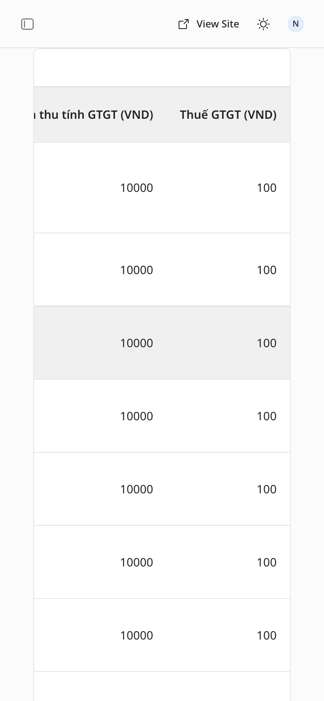

**Mục tiêu**

Tìm các cột ngoài khung nhìn mà không tưởng dữ liệu đã biến mất.

**Thao tác**

1. Trên màn hình nhỏ, mở đúng hồ sơ, **Xem / xuất sổ**, mẫu S2b-HKD và tháng 2.
2. Đặt ngón tay trong vùng bảng chi tiết, vuốt ngang để xem các cột bên phải; vuốt trở lại để đối chiếu ngày và chứng từ.
3. Cuộn dọc trang để xem điều hướng trang và tổng hợp toàn kỳ. Với bàn phím, đưa tiêu điểm vào vùng bảng rồi cuộn ngang bằng phím phù hợp của thiết bị.

**Kiểm tra trước khi tiếp tục**

- Bảng cuộn bên trong vùng của nó; không cần kéo cả trang rộng ra hoặc coi cột ngoài màn hình là cột bị thiếu.
- Giữ đúng hàng khi đối chiếu số; kiểm tra lại tiêu đề cột sau mỗi lần cuộn.
- Phân trang và xuất toàn bộ vẫn có ý nghĩa như trên máy tính; màn hình nhỏ không đổi phạm vi dữ liệu.

**Lời đọc**

“Trên điện thoại, một sổ nhiều cột không thể hiện hết cùng lúc. Hãy vuốt ngang ngay trong vùng bảng để đọc các cột còn lại, rồi trở lại cột chứng từ khi cần đối chiếu. Đừng chỉ kéo ở khoảng trống ngoài bảng, vì đó là thao tác cuộn trang. Khi chuyển sang một cột tiền khác, luôn nhìn lại tiêu đề để tránh nhầm doanh thu với cơ sở tính thuế. Bạn vẫn có thể chuyển trang và xuất toàn kỳ như trên máy tính. Điện thoại chỉ thay đổi cách nhìn; nó không làm số dòng trong sổ ít đi.”

## 047 — Thiết lập ví dụ riêng: TNCN theo tỷ lệ doanh thu

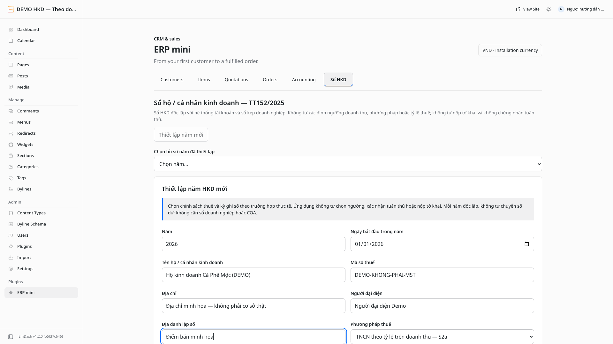

**Mục tiêu**

Nhận biết phương pháp doanh thu trong một cài đặt minh họa độc lập, không đổi hồ sơ thu nhập đã lập.

**Thao tác**

1. Phần ghi hình chuyển sang cài đặt demo doanh thu độc lập, dùng cổng `4324` lúc ghi và hiện đã tắt. Khi tự làm, chọn nhánh này ngay sau khung 009 trên cài đặt chưa có hồ sơ năm 2026; không thực hiện thiết lập thu nhập ở khung 010 trước, không đổi hồ sơ thu nhập đã lập và không mở địa chỉ demo đã tắt.
2. Trong **Thiết lập năm HKD mới**, nhập **Năm** `2026`, **Ngày bắt đầu trong năm** `2026-01-01`, tên `Hộ kinh doanh Cà Phê Mộc (DEMO)`, mã số thuế `DEMO-KHONG-PHAI-MST`.
3. Nhập địa chỉ `Địa chỉ minh họa — không phải cơ sở thật`, người đại diện `Người đại diện Demo`, địa danh `Điểm bán minh họa`.
4. Chọn **Phương pháp thuế → TNCN theo tỷ lệ trên doanh thu — S2a**, **Kỳ định giá và báo cáo → Quý**. Không chọn **Có thuế khác: mở sổ S3a-HKD**.

**Kiểm tra trước khi tiếp tục**

- Cả ba cài đặt minh họa đều dùng năm 2026, không dùng năm khác để sửa phương pháp đã khóa.
- Không có trường thuế suất TNCN trên thu nhập trong cấu hình phương pháp này; cơ sở và tỷ lệ TNCN sẽ được nhập rõ trên từng doanh thu.
- Phương pháp phải được xác định theo tình huống pháp lý thực tế, không chọn vì ví dụ có doanh thu tương tự mình.

**Lời đọc**

“Từ đây chúng ta chuyển sang một cài đặt demo khác, vẫn là năm hai nghìn không trăm hai mươi sáu. Đây không phải đổi phương pháp của hộ đang ghi sổ thu nhập. Ở phương pháp tỷ lệ trên doanh thu, ví dụ chọn kỳ quý và dùng sổ S2a. Bạn sẽ không nhập mức TNCN trên thu nhập ở hồ sơ này; khi ghi doanh thu, bạn phải tự khai cơ sở và tỷ lệ tương ứng. Hãy kiểm tra cài đặt và phương pháp trước khi xác nhận, vì hồ sơ năm là bất biến. Ứng dụng không dựa vào tên ngành hay doanh thu để tự quyết định bạn thuộc phương pháp nào.”

## 048 — Kiểm tra hồ sơ doanh thu trước khi ghi

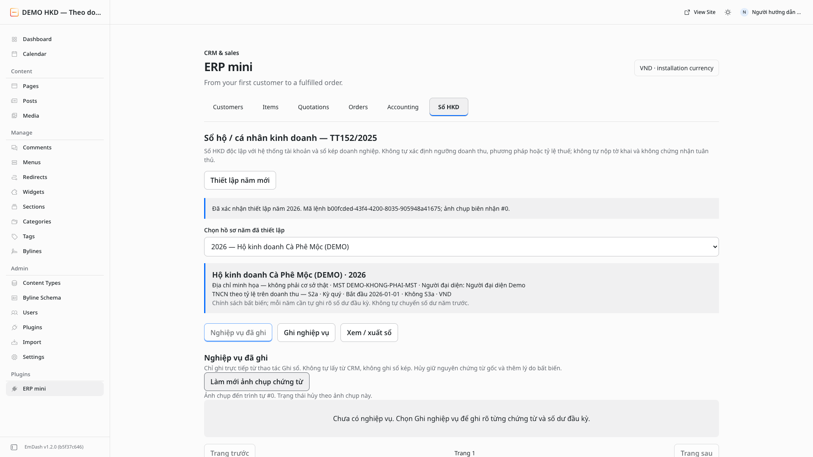

**Mục tiêu**

Xác nhận đúng chính sách năm và nhận biết phạm vi sổ được mở.

**Thao tác**

1. Đọc lại biểu mẫu ở khung trước; bấm **Xác nhận thiết lập bất biến** và chỉ chấp nhận hộp xác nhận khi mọi thông tin đều đúng.
2. Kiểm tra hồ sơ hiện tên demo, năm `2026`, phương pháp **TNCN theo tỷ lệ trên doanh thu — S2a**, kỳ quý, bắt đầu `2026-01-01`, **Không S3a**.
3. Chọn **Ghi nghiệp vụ** để chuẩn bị doanh thu của quý 1.

**Kiểm tra trước khi tiếp tục**

- Không phải hồ sơ thu nhập có S2b–S2e và mức 17% ở chương trước.
- Bài này không suy ra có biểu mẫu kho, chi phí hoặc tiền cho phương pháp doanh thu.
- Nếu đã xác nhận sai chính sách, dừng và nhờ người vận hành đối chiếu; không tạo một năm khác để che hoặc thay thế hồ sơ sai.

**Lời đọc**

“Sau xác nhận, chúng ta đọc lại tóm tắt hồ sơ thay vì chuyển ngay sang nhập số. Tên hộ giống ví dụ trước nhưng cài đặt này độc lập, dùng phương pháp doanh thu và kỳ quý. Điều đó quyết định cách chúng ta chọn kỳ báo cáo và những trường sẽ thấy trên biểu mẫu. Đừng mang mức mười bảy phần trăm của ví dụ thu nhập sang đây, cũng đừng tìm cách ghi tiền hay kho theo giả định từ chương trước. Nếu thông tin đã khóa bị sai, cần đối chiếu với người vận hành. Tạo hồ sơ năm sau không phải cách sửa lại chính sách của năm hiện tại.”

## 049 — Nhập riêng doanh thu thực tế, hai cơ sở và hai tỷ lệ

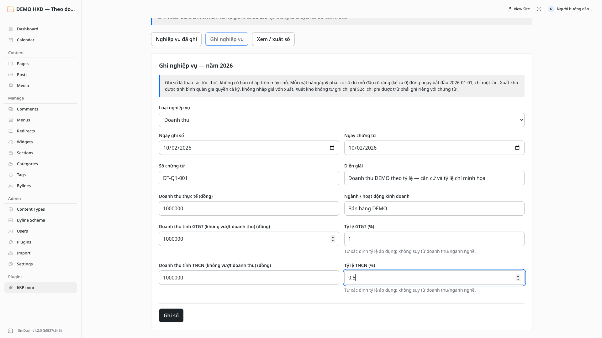

**Mục tiêu**

Không nhầm số bán hàng với cơ sở GTGT hoặc cơ sở TNCN dù trong ví dụ chúng bằng nhau.

**Thao tác**

1. Chọn **Ghi nghiệp vụ**, loại **Doanh thu**; nhập ngày ghi và ngày chứng từ `2026-02-10`, số chứng từ `DT-Q1-001`, diễn giải `Bán hàng DEMO theo phương pháp doanh thu`.
2. Nhập **Doanh thu thực tế (đồng)** `1000000`, **Ngành / hoạt động kinh doanh** `Bán hàng DEMO`.
3. Nhập **Doanh thu tính GTGT (không vượt doanh thu) (đồng)** `1000000`, **Tỷ lệ GTGT (%)** `1`.
4. Nhập **Doanh thu tính TNCN (không vượt doanh thu) (đồng)** `1000000`, **Tỷ lệ TNCN (%)** `0.5`.
5. Đối chiếu chứng từ rồi bấm **Ghi sổ**, xác nhận ghi ngay.

**Kiểm tra trước khi tiếp tục**

- Hai cơ sở đều được nhập rõ, không tự suy từ doanh thu hoặc ngành nghề.
- Cả `1%` và `0,5%` chỉ là tỷ lệ minh họa; trong ô số thập phân dùng `0.5`.
- Dự kiến GTGT `10.000`, TNCN `5.000` đồng. Không có trường doanh thu tính thu nhập S2c ở phương pháp này.

**Lời đọc**

“Một triệu đồng bán hàng được nhập vào doanh thu thực tế. Sau đó chúng ta nhập riêng cơ sở GTGT và cơ sở TNCN, dù trong ví dụ cả hai cũng là một triệu. Các ô này mang ý nghĩa khác nhau, nên không được mặc định luôn giống doanh thu. Tỷ lệ GTGT một phần trăm và TNCN không phẩy năm phần trăm đều là số minh họa đã chọn cho bài học, không phải ứng dụng suy ra từ dòng Bán hàng DEMO. Khi nhập số thập phân, dùng dấu chấm trong ô. Chỉ ghi sổ sau khi đã đối chiếu chứng từ và căn cứ xác định cơ sở, tỷ lệ của trường hợp thật.”

## 050 — Đối chiếu S2a quý 1

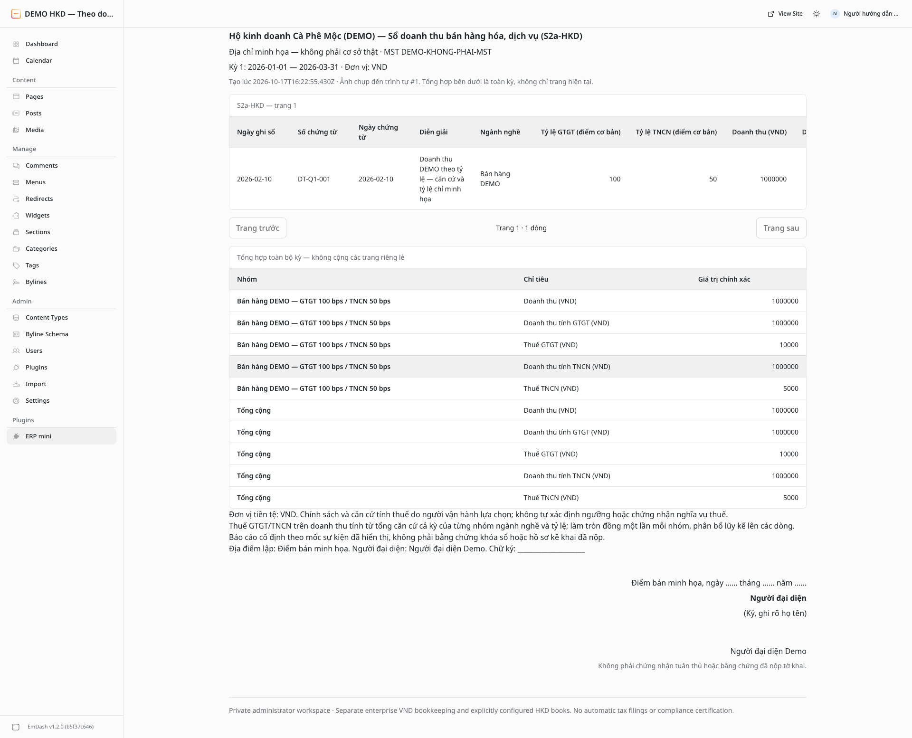

**Mục tiêu**

Kiểm tra đúng sổ, đúng quý và phép tính của từng loại thuế.

**Thao tác**

1. Chọn **Xem / xuất sổ**, **Mẫu sổ → S2a-HKD**, **Kỳ quý → 1**.
2. Đối chiếu khoảng kỳ quý 1 năm 2026 và dòng ngày `2026-02-10`.
3. Đọc doanh thu `1.000.000`, cơ sở GTGT `1.000.000`, GTGT `10.000`, cơ sở TNCN `1.000.000`, TNCN `5.000` đồng ở phần chi tiết và tổng hợp phù hợp.

**Kiểm tra trước khi tiếp tục**

- `1.000.000 × 1% = 10.000`; `1.000.000 × 0,5% = 5.000`.
- Quý 1 gồm tháng 2 của chứng từ; không tìm dữ liệu này trong cài đặt thu nhập hoặc trong một kỳ tháng riêng.
- Sổ không phải biên nhận đã nộp thuế hay tờ khai đã gửi.

**Lời đọc**

“Chứng từ ngày mười tháng hai nằm trong quý một, nên chúng ta chọn quý một của sổ S2a. Doanh thu là một triệu đồng; với cơ sở đã nhập và các tỷ lệ minh họa, GTGT là mười nghìn, TNCN là năm nghìn đồng. Bạn nên kiểm tra từng cơ sở cùng tỷ lệ trước khi chỉ nhìn kết quả cuối. Nếu sổ trống, trước tiên xem lại cài đặt, hồ sơ năm và quý được chọn, không ghi thêm một chứng từ mới để thử. Sổ này hỗ trợ đối chiếu số đã ghi, nhưng không xác nhận rằng khoản thuế đã được kê khai hoặc thanh toán.”

## 051 — Thiết lập ví dụ riêng cho S1a, không tự xét miễn thuế

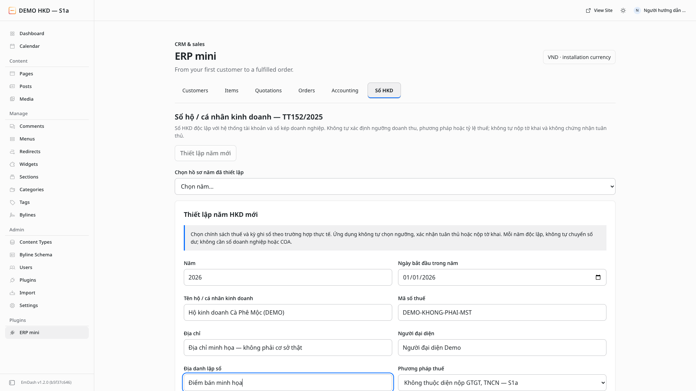

**Mục tiêu**

Hiểu lựa chọn S1a là chính sách do người dùng xác định có căn cứ, không phải kết luận pháp lý của phần mềm.

**Thao tác**

1. Phần ghi hình dùng một cài đặt demo riêng nữa, cổng `4325` lúc ghi và hiện đã tắt. Khi tự làm, chọn nhánh S1a ngay sau khung 009 trên cài đặt chưa có hồ sơ năm 2026; không tạo hồ sơ thu nhập/doanh thu ở các nhánh khác trước rồi tìm cách đổi phương pháp.
2. Nhập cùng danh tính demo: năm `2026`, bắt đầu `2026-01-01`, tên `Hộ kinh doanh Cà Phê Mộc (DEMO)`, mã số thuế `DEMO-KHONG-PHAI-MST`, địa chỉ `Địa chỉ minh họa — không phải cơ sở thật`, người đại diện `Người đại diện Demo`, địa danh `Điểm bán minh họa`.
3. Chọn **Phương pháp thuế → Không thuộc diện nộp GTGT, TNCN — S1a**, **Kỳ định giá và báo cáo → Năm**; không bật S3a.
4. Kiểm tra kỹ trước khi **Xác nhận thiết lập bất biến** và chấp nhận xác nhận.

**Kiểm tra trước khi tiếp tục**

- Vẫn là năm 2026 trên cài đặt khác, không phải thay đổi chính sách trong một hồ sơ năm.
- Nhãn lựa chọn không chứng minh hộ thực tế đủ điều kiện; ứng dụng không tự xét ngưỡng hoặc miễn thuế.
- Không nhập tỷ lệ GTGT/TNCN để tạo ra kết luận miễn trên màn hình này.

**Lời đọc**

“Ví dụ cuối dùng một cài đặt riêng nữa và chọn sổ S1a theo phương pháp không thuộc diện nộp GTGT, TNCN. Đây là lựa chọn người dùng đưa vào sau khi đã xác định trường hợp thực tế, không phải kết quả xét duyệt của phần mềm. Chúng ta vẫn dùng năm hai nghìn không trăm hai mươi sáu để tránh hiểu nhầm rằng sang năm khác là đổi được hồ sơ cũ. Kỳ báo cáo ở đây là cả năm. Trước khi xác nhận, hãy kiểm tra căn cứ của lựa chọn này với người có chuyên môn. Số doanh thu nhỏ trong bài học không tự động tạo quyền miễn thuế.”

## 052 — Ghi doanh thu S1a không có ô cơ sở GTGT/TNCN

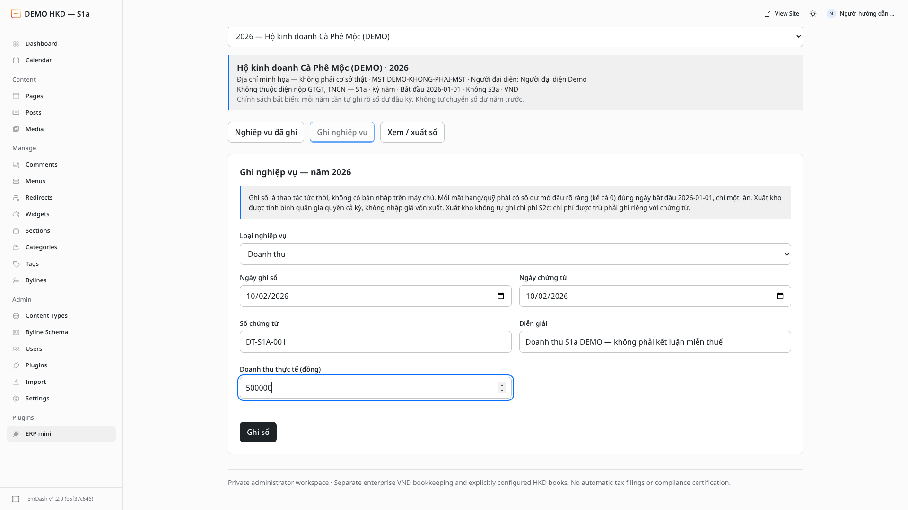

**Mục tiêu**

Ghi doanh thu theo đúng biểu mẫu của hồ sơ, không thêm cơ sở tính thuế từ phương pháp khác.

**Thao tác**

1. Kiểm tra tóm tắt hồ sơ 2026 đúng phương pháp S1a, kỳ năm và không S3a.
2. Chọn **Ghi nghiệp vụ → Doanh thu**; nhập ngày ghi và ngày chứng từ `2026-02-10`, số chứng từ `DT-S1A-001`, diễn giải `Doanh thu DEMO ghi S1a`.
3. Nhập **Doanh thu thực tế (đồng)** `500000`, kiểm tra rồi bấm **Ghi sổ** và xác nhận.

**Kiểm tra trước khi tiếp tục**

- Biểu mẫu này không có cơ sở hay tỷ lệ GTGT/TNCN; không tìm cách thêm chúng như ở S2a.
- Doanh thu `500.000` là số ghi sổ, không phải giấy xác nhận không phát sinh nghĩa vụ thuế.
- Không suy ra một nghiệp vụ thu tiền tự động từ dòng doanh thu.

**Lời đọc**

“Ở hồ sơ S1a, biểu mẫu doanh thu ngắn hơn: chúng ta ghi ngày, chứng từ, diễn giải và doanh thu thực tế năm trăm nghìn đồng. Không có ô cơ sở hoặc tỷ lệ GTGT, TNCN như ví dụ S2a. Điều này phản ánh phương pháp của hồ sơ đã chọn, chứ không có nghĩa ứng dụng vừa kiểm tra và chứng nhận được miễn thuế. Bạn vẫn phải ghi trung thực doanh thu và giữ chứng từ làm căn cứ. Cũng như các bài trước, doanh thu là một loại thông tin nghiệp vụ; đừng tự hiểu việc ghi doanh thu này là đã thu tiền hoặc đã hoàn thành nghĩa vụ kê khai.”

## 053 — S1a là sổ doanh thu, không là chứng nhận miễn

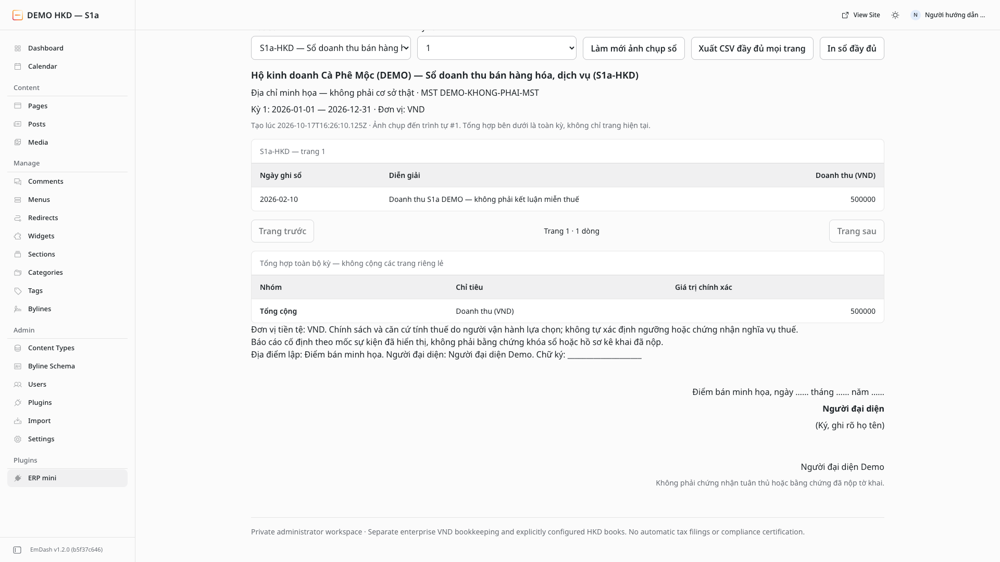

**Mục tiêu**

Đọc được kết quả S1a và không suy diễn từ việc thiếu cột thuế thành một kết luận pháp lý.

**Thao tác**

1. Chọn **Xem / xuất sổ → Mẫu sổ → S1a-HKD**, **Kỳ năm → 1** của hồ sơ 2026.
2. Kiểm tra khoảng kỳ năm 2026, dòng `DT-S1A-001` ngày `2026-02-10` và doanh thu `500.000` đồng.
3. Đối chiếu tổng hợp toàn năm với dòng đã ghi; đọc ghi chú và cảnh báo ở cuối sổ trước khi xuất hoặc ký.

**Kiểm tra trước khi tiếp tục**

- Chỉ kết luận sổ ghi nhận doanh thu `500.000` đồng trong dữ liệu minh họa.
- Không kết luận “thuế bằng 0”, “được miễn hợp pháp” hoặc “đã nộp tờ khai” chỉ vì sổ S1a không có cột tính thuế.
- Muốn xác định nghĩa vụ thực tế phải kiểm tra điều kiện, thời điểm và hồ sơ theo quy định áp dụng, ngoài phạm vi tính toán của màn hình này.

**Lời đọc**

“S1a cho thấy doanh thu năm trăm nghìn đồng đã được ghi trong kỳ năm. Chúng ta đối chiếu chứng từ và tổng hợp, rồi dừng kết luận ở đó. Việc sổ này không trình bày số GTGT hoặc TNCN không phải bằng chứng thuế bằng không, cũng không chứng minh hộ đủ điều kiện miễn. Ứng dụng đang trình bày dữ liệu theo chính sách mà người dùng đã chọn. Căn cứ pháp lý cho phương pháp, việc kê khai và việc thanh toán phải được kiểm tra riêng. Khi xuất hoặc ký sổ, người đại diện vẫn cần rà soát nội dung và giữ hồ sơ chứng minh, không dùng tên mẫu sổ thay cho việc xác định nghĩa vụ.”

## 054 — Bắt đầu ở dev sạch bằng tài khoản và passkey của chính bạn

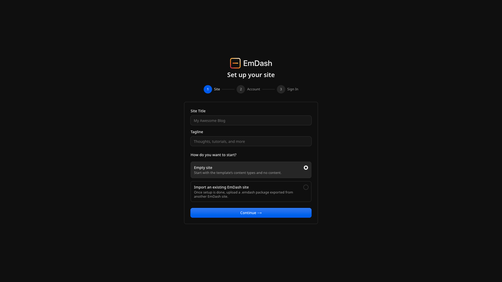

**Mục tiêu**

Phân biệt môi trường tự thực hành chưa nhận chủ với các cài đặt demo đã dùng để ghi hình.

**Thao tác**

1. Mở `http://localhost:4337` trên máy đang chạy dev, kiểm tra đây là luồng thiết lập người dùng đầu tiên, chưa phải bảng điều khiển đã đăng nhập. Các cổng 4323–4326 trong metadata ảnh chỉ phục vụ lần ghi demo và hiện đã tắt.
2. Thực hiện các bước thiết lập ban đầu theo phần mở đầu bộ hướng dẫn; dùng danh tính quản trị và thông tin do chính bạn sở hữu, không sao chép thông tin demo hoặc tài khoản của người ghi hình.
3. Đến lựa chọn passkey, đăng ký bằng trình duyệt và thiết bị của bạn theo hướng dẫn hiển thị. Không chia sẻ passkey, mã khôi phục hay ảnh có thông tin bí mật.
4. Sau khi nhận chủ và vào workspace, tự xác định phương pháp phù hợp rồi thiết lập hồ sơ HKD của mình. Không mặc định có sẵn ba bộ dữ liệu minh họa.

**Kiểm tra trước khi tiếp tục**

- Khung 054 là dev sạch chưa có người dùng đầu tiên, không phải một demo đã đăng nhập sẵn.
- Nếu thấy tài khoản, chính sách hoặc dữ liệu không thuộc mình, dừng và kiểm tra với người vận hành; không xóa dữ liệu để làm giống video.
- Không thao tác vào cài đặt đang dùng khác hoặc dữ liệu thật để thực hành.

**Lời đọc**

“Phần thực hành của bạn bắt đầu ở một dev sạch, chưa cấu hình người dùng đầu tiên. Đây không phải bản demo đăng nhập sẵn của người ghi hình. Bạn tự hoàn tất thiết lập và có thể đăng ký passkey trên thiết bị của mình, nhờ vậy thông tin đăng nhập thuộc quyền kiểm soát của bạn. Đừng sao chép tài khoản hay khóa của người khác. Những số liệu trong video chỉ để học cách kiểm tra; dev mới không tự có các chứng từ đó. Khi vào workspace, hãy xác định phương pháp và căn cứ đầu kỳ phù hợp trước khi ghi. Nếu nhìn thấy dữ liệu có sẵn ngoài dự kiến, dừng lại để người vận hành xác nhận đúng môi trường.”

**Gợi ý dựng**

Giữ màn hình đầu tiên chưa nhận chủ; không điền thông tin riêng hay chụp thao tác tạo bí mật của người học.

## Hỏi nhanh khi tự làm

**Bị lỗi âm quỹ thì cứ tăng đầu kỳ được không?** Không. Đối chiếu tiền thực tế, ngày, quỹ và chứng từ. Chỉ ghi số dư hoặc phát sinh có căn cứ; việc làm hệ thống hết báo lỗi không chứng minh sổ đúng. Kiểm tra có thể xét các thời điểm trong lịch sử, không chỉ số dư cuối kỳ.

**Quỹ hoặc mặt hàng đầu kỳ bằng 0 có cần khai không?** Có. Mỗi mặt hàng/quỹ phải có dòng đầu kỳ rõ ràng đúng ngày bắt đầu năm của hồ sơ, kể cả 0. Không tự chuyển số dư từ năm trước.

**Mạng lỗi thì ghi lại chứng từ mới cho nhanh được không?** Không khi kết quả chưa rõ. Giữ nguyên phiên và dùng **Thử lại / đối soát cùng lệnh gốc**. Nếu mất hoặc sai phạm vi hồ sơ gốc, nhờ người vận hành đối chiếu; không dùng tài nguyên thay thế.

**Trang hai có 5 dòng, CSV cũng chỉ có 5 dòng?** Không trong ví dụ này. Trang 1 có 25, trang 2 có 5; các nút xuất đầy đủ thu thập cả 30 dòng cùng ảnh chụp. Vẫn phải kiểm tra tệp tải xuống thực tế.

**Sao nghiệp vụ vừa ghi không xuất hiện khi bấm Trang trước?** Các trang giữ cùng ảnh chụp. Chủ động dùng **Làm mới ảnh chụp sổ** hoặc **Làm mới ảnh chụp chứng từ** đúng nơi đang xem, rồi đối chiếu lại kỳ và bộ lọc.

**Đã ghi sai có sửa trực tiếp được không?** Không. Dùng **Hủy với lý do** và ghi chứng từ đúng mới khi được phép; giữ lịch sử, không sửa/xóa bản gốc. Nếu chỉ sửa chi phí được trừ, không tự ghi thêm khoản chi tiền đã thanh toán trước đó.

**Có thể chọn năm sau để đổi phương pháp đã thiết lập sai không?** Không. Hồ sơ năm bất biến; ba ví dụ ở đây dùng ba cài đặt độc lập cùng năm 2026. Nhờ người vận hành xử lý sai phạm vi, không dùng năm mới để che hồ sơ sai.

**Tên ngành giúp phần mềm tự chọn tỷ lệ thuế?** Không. Người dùng tự xác định cơ sở và tỷ lệ theo căn cứ áp dụng. Mọi tỷ lệ `1%`, `0,5%` và `17%` trong bài đều chỉ minh họa phép tính.

**S1a có chứng minh được miễn hoặc không còn nghĩa vụ thuế không?** Không. S1a ở đây là sổ doanh thu theo lựa chọn hồ sơ; ứng dụng không tự xét điều kiện miễn và không tự nộp tờ khai.

## Ranh giới sao lưu — chỉ dành cho người vận hành

CSV, bản in và PDF là bản đọc để kiểm tra/lưu sổ, không phải bản sao lưu có thể phục hồi toàn bộ lịch sử, lệnh đang chờ hoặc môi trường. Không có nút “sao lưu toàn hệ thống” được giới thiệu trong chương này.

Người dùng đề nghị người vận hành thực hiện sao lưu nhất quán theo [hướng dẫn lưu trữ và vận hành — bản nguồn cố định](https://github.com/ZeroHostCMS/zhst-community-plugins/blob/c99dc944188d3f0f608007b406bf11f9d1132208/plugins/erp-mini/docs/accounting-storage.md), bao gồm dữ liệu CMS, dữ liệu accounting và phần WAL liên quan bằng cơ chế SQLite-aware, media, key và phiên bản mã tương thích. Không tự sao chép riêng tệp dữ liệu chính khi hệ thống còn ghi; không chia sẻ key trong tài liệu hoặc qua ảnh. Việc sao lưu, thử phục hồi, nâng cấp và triển khai thuộc trách nhiệm người vận hành, không phải thao tác thực hành của người ghi sổ. Chương này không cung cấp lệnh triển khai, migration hay giao diện sao lưu giả.
